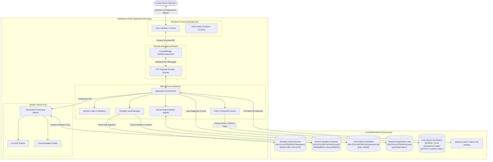
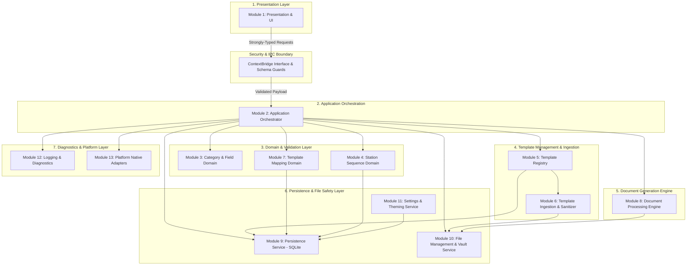

# OpsReport Studio — Application Architecture Specification

**Document Identifier:** ARCH-SPEC-002  
**Project ID:** stationops-reporter  
**Approved Product Name:** OpsReport Studio  
**Lifecycle Step:** Step 6 of 45 (Application Architecture, Module Boundaries & Security Model)  
**Status:** Authoritative Architecture Specification  
**Last Updated:** 2026-10-19  

---

## 1. Project Identity & Roadmap Context

* **Project Name:** OpsReport Studio
* **Project ID:** `stationops-reporter`
* **Product Type:** Offline Desktop Operational Report-Generation Application
* **Primary Domain:** Operational reporting, security incident documentation, infrastructure asset inspection, document automation, and secure local file management.
* **Target Users:** Control room representatives, facility security supervisors, and authorized station reporting personnel.
* **Roadmap Position:** Step 6 of 45 (Phase 2: Architectural Specification & Foundation).
  * *Preceding Steps:* Step 1 (Requirements Baseline), Step 2 (Report Catalog & Fields), Step 3 (Station Ordering Specification), Step 4 (Document Compatibility & Template Security), Step 5 (Technology Evaluation & ADR-OPSREPORT-001).
  * *Immediate Successor:* Step 7 (Document Processing Engine Proof of Concept & Benchmark).

---

## 2. Architecture Objectives & Engineering Principles

OpsReport Studio provides a reliable, secure, and ergonomic desktop environment for creating standardized operational reports from reusable Microsoft Excel (`.xlsx`) and Word (`.docx`) master templates.

### 2.1 Core Objectives
1. **Absolute Master Template Immutability (`REQ-006`, `NFR-REL-01`):** Master templates residing in the managed Template Vault must never be opened with write permissions, mutated in-place, or targeted as report output destinations.
2. **Authoritative Station Sequence Preservation (`REQ-008`):** Multi-station inspection reports must enforce strict 1..N sequential ordering as defined in operational contracts, prohibiting unsanctioned sorting, deduplication, or truncation.
3. **Structured Form-Based Entry (`REQ-007`):** Operators record observations through modern, responsive form controls with instantaneous validation, eliminating direct interaction with raw spreadsheet grids or complex word processor interfaces.
4. **Offline Air-Gapped Operation (`NFR-SEC-01`, `DEC-001`):** Zero external network calls, zero public AI/LLM API reliance, zero telemetry transmission, and 100% local persistence.
5. **High-Fidelity Document Generation (`REQ-002`, `REQ-003`):** Generated workbooks and documents must preserve all pre-existing formulas, formatting rules, styles, print setups, and header layouts without requiring Microsoft Office or COM automation installed on the host (`NFR-COMP-02`).
6. **Defense-in-Depth Security (`NFR-SEC-02`, `SEC-ARCH-001`):** Strict process isolation, zero Node.js access in renderer views, rigid Content Security Policy, and defensive Open XML archive ingestion.

### 2.2 Engineering Principles
* **Simplicity over Overengineering:** A modular monolithic desktop architecture is chosen. No microservices, no background daemon services, no cloud databases, and no distributed event buses.
* **Process Boundary Realism:** Clear distinction between logical module encapsulation (clean architectural boundaries) and actual OS process distribution (Electron Main Process, Sandboxed Renderer, and Node.js Background Worker Threads).
* **Defensive Failure Handling:** Database writes and filesystem updates do not share a distributed two-phase commit. The architecture implements a two-phase reservation pattern with explicit cleanup and reconciliation.

---

## 3. Technology Stack Baseline & Decision Status

The architecture conforms strictly to the decisions established in **Step 5** (`ADR-OPSREPORT-001`, `OPSREPORT_STUDIO_TECHNOLOGY_EVALUATION.md`):

| Layer / Subsystem | Selected Technology | Version Baseline | Architectural Role | Status |
| :--- | :--- | :--- | :--- | :--- |
| **Desktop Runtime** | Electron | v32+ LTS | OS host container, window lifecycle, native dialogs, process isolation | Approved Baseline |
| **UI Presentation** | React | 18.3+ | Component-driven form views, catalog navigation, reactive feedback | Approved Baseline |
| **Language & Typings** | TypeScript | 5.5+ | End-to-end strict static type safety across IPC and domain services | Approved Baseline |
| **Frontend Bundler** | Vite | 5.x | High-speed ESM development and optimized production asset bundling | Approved Baseline |
| **Styling & Theming** | Vanilla CSS + CSS Modules | Modern CSS3 | Semantic CSS custom properties for Dark/Light theme switching (`REQ-011`) | Approved Baseline |
| **Excel Document Engine** | `exceljs` | v4.4+ | Headless Open XML workbook manipulation, cell value injection, style preservation | Approved (Step 7 Verification Gate) |
| **Word Document Engine** | `docxtemplater` + `pizzip` | v3.47+ / v3.1+ | Headless Open XML split-run token replacement, table population | Approved (Step 7 Verification Gate) |
| **Embedded Database** | `better-sqlite3` | v11+ | High-performance synchronous SQLite in WAL mode for metadata and drafts | Approved Baseline |
| **File Sandbox / Worker** | Node.js Worker Threads | Node v20 LTS | Background document compilation off the main UI loop (`NFR-PERF-01`) | Approved Baseline |

### 3.1 Provisional Decisions & Step 7 Verification Gates
* **Excel Engine Benchmark (`POC-XLS`):** Subject to Step 7 validation that `exceljs` preserves complex formulas (`SUMIF`, `VLOOKUP`), merged title blocks, and drawing anchors in actual control room templates. If regression occurs, ClosedXML (.NET sidecar) is the evaluated fallback.
* **Word Split-Run Benchmark (`POC-DOC`):** Subject to Step 7 validation that the MIT core of `docxtemplater` performs multi-paragraph and table token substitutions without requiring proprietary commercial add-ons.
* **Supervisor Access Control (`DEC-017`):** Initial release operates on single-tier console access. An optional PIN-protected Supervisor Mode for template authoring remains provisional.

---

## 4. System Context & Environment Interactions

OpsReport Studio runs as a self-contained local desktop application on Windows 10/11 64-bit operator consoles (`NFR-COMP-01`).

### 4.1 System Context Model



### 4.2 Environmental Interaction Specifications

| Interaction | Responsible Component | Information Exchanged | Trust Boundary Crossed | Required OS Permission | Primary Failure Modes | Validation Required |
| :--- | :--- | :--- | :--- | :--- | :--- | :--- |
| **Template Import Dialog** | `PlatformAdapter` via OS Shell | Selected file path (`.xlsx`/`.docx`) | OS Shell $\rightarrow$ Main Process | Read access to selected file | User cancels, file locked by Office, network path unreachable | Path canonicalization, file extension check, file existence |
| **Template Vault Ingestion** | `TemplateVaultManager` | Raw template file stream | External File $\rightarrow$ Internal App Data | Write access to `%LOCALAPPDATA%` | Disk full, antivirus file lock, read-only external media | ZIP magic byte validation (`PK\x03\x04`), macro quarantine (`vbaProject.bin`), zip bomb ceiling |
| **Scratch Copy Creation** | `FileManagementService` | Read stream from Master $\rightarrow$ Write stream to Scratch | Vault $\rightarrow$ Scratch Sandbox | Read from Vault, Write to Scratch | Disk full, temp directory permission error | Target path verification (`Scratch != Vault`), SHA-256 integrity check |
| **Document Compilation** | `DocumentProcessingWorker` | In-memory report payload + scratch file | Main Thread $\rightarrow$ Worker Thread | Worker thread CPU/RAM allocation | Out of memory, invalid token syntax, corrupted XML node | Payload schema validation, token syntax resolution, engine error traps |
| **Final Export Movement** | `AtomicExporter` | File move from Scratch $\rightarrow$ User Destination | Scratch Sandbox $\rightarrow$ User Filesystem | Write access to user target directory | Target folder unwritable, filename collision, disk quota exceeded | Path traversal prevention, collision policy check (`RENAME` vs `PROMPT`), destination existence verification |
| **Database Persistence** | `PersistenceService` | Relational records (stations, templates, drafts) | Main Process $\rightarrow$ SQLite File | Read/Write to `%LOCALAPPDATA%/opsreport.db` | Database file locked, disk full, corrupted header | WAL mode active, synchronous = NORMAL, foreign key constraints active |
| **Diagnostic Logging** | `LoggingService` | Operational event records | Main Process $\rightarrow$ Log Files | Append to `%LOCALAPPDATA%/Logs` | Log rotation failure, disk full | Field-level sanitization filter (strips narratives, witness text, badge numbers) |

---

## 5. Architectural Style & Process Topology

### 5.1 Architectural Style: Modular Monolithic Desktop Application
OpsReport Studio adopts a **Modular Monolithic Desktop Architecture**. Functional subsystems are organized into cohesive, loosely coupled logical modules residing within a single deployable desktop package.

#### Justification Against Alternatives:
1. **Against Microservices / Multi-Process Daemons:** A desktop report generator operating air-gapped on a single operator console has zero need for network serialization, service discovery, distributed tracing, or container runtimes. Microservices would introduce unacceptable latency, memory overhead, and failure modes.
2. **Against Unstructured Single-File Scripting:** Unstructured code risks mixing UI state, raw filesystem operations, and Open XML manipulation, making automated unit testing and security boundary enforcement impossible.
3. **Against Heavy Plugin Frameworks:** Dynamic third-party plugin loading presents significant attack surface (arbitrary DLL/script execution in control rooms) and is completely unnecessary for a fixed 7-category reporting tool.

### 5.2 Process Topology & Boundary Model
The logical modules map across **three concrete execution boundaries**:

```
┌────────────────────────────────────────────────────────────────────────┐
│ PROCESS 1: Chromium Renderer Process (SANDBOXED)                       │
│ • Module 1: Presentation & UI Module                                   │
│ • Sandboxed, zero Node.js access, strict Content Security Policy       │
│ • Communicates exclusively via window.opsreport                        │
└───────────────────────────────────┬────────────────────────────────────┘
                                    │ IPC (Preload ContextBridge)
┌───────────────────────────────────▼────────────────────────────────────┐
│ PROCESS 2: Node.js Main Process (TRUSTED CORE)                         │
│ • Module 2: Application Orchestration Module                           │
│ • Module 3: Report Category & Field Definition Module                  │
│ • Module 4: Station Configuration & Sequence Module                    │
│ • Module 5: Template Registry & Metadata Module                        │
│ • Module 6: Template Import & Ingestion Security Module                │
│ • Module 7: Template Mapping Module                                    │
│ • Module 9: Persistence Module (SQLite WAL)                            │
│ • Module 10: File Management & Vault Boundary Module                   │
│ • Module 11: Settings & Theme Module                                   │
│ • Module 12: Logging & Diagnostics Module                              │
│ • Module 13: Platform & Native Dialog Adapters                         │
└───────────────────────────────────┬────────────────────────────────────┘
                                    │ Thread MessageChannel
┌───────────────────────────────────▼────────────────────────────────────┐
│ PROCESS 3: Node.js Worker Thread Pool (ISOLATED WORKERS)               │
│ • Module 8: Document Processing Module (ExcelJS & Docxtemplater)       │
│ • Offloads CPU-intensive ZIP compression and Open XML tree parsing     │
│ • Prevents UI thread frame drops; keeps interface locked at 60 FPS     │
└────────────────────────────────────────────────────────────────────────┘
```

---

## 6. Logical Module Architecture & Boundaries



### 6.1 Module Catalogue Summary

| Module ID | Module Name | Primary Responsibility | Input Boundary | Output Boundary | Allowed Callers | Forbidden Responsibilities |
| :--- | :--- | :--- | :--- | :--- | :--- | :--- |
| **MOD-01** | Presentation & UI | User interaction, form rendering, station pickers, theme switching | User input, IPC event responses | Validated IPC requests to Bridge | Renderer runtime | Direct filesystem I/O, direct SQL, master template writes |
| **MOD-02** | Application Orchestrator | Workflow coordination, generation pipeline, transaction boundaries | IPC requests from MOD-01 | Workflow outcomes, progress events | MOD-01 (via IPC) | Low-level XML parsing, UI rendering, direct DB queries |
| **MOD-03** | Category & Field Domain | Definition and validation of 7 report schemas and fields | Field value dictionaries | Validation result objects | MOD-02 | Template coordinate mapping, UI rendering, file I/O |
| **MOD-04** | Station Sequence Domain | Authoritative station sequence preservation, 1..N ordinality | Station configuration payloads | Ordered station entities, validation | MOD-02, MOD-07 | Arbitrary alphabetical sorting, silent deduplication |
| **MOD-05** | Template Registry | Metadata registry, template versioning, active template resolution | Registration commands, queries | Template metadata records | MOD-02 | File payload parsing, output report generation |
| **MOD-06** | Template Ingestion & Sanitizer | Defensive Open XML inspection, macro quarantine, zip bomb guard | Raw file buffer / path from dialog | Clean template artifact, security report | MOD-05 | Executing embedded macros, trusting external DTDs |
| **MOD-07** | Template Mapping Domain | Field-to-cell (`.xlsx`) and field-to-token (`.docx`) mappings | Mapping configuration profiles | Verified mapping resolution | MOD-02 | Guessing ambiguous targets, silent field drop |
| **MOD-08** | Document Processing Engine | Headless workbook and document population on scratch copies | Scratch file path, mapping, payload | Populated document outcome | MOD-02 (Worker dispatch) | Mutating master templates, writing outside scratch sandbox |
| **MOD-09** | Persistence Service | Local relational storage (`better-sqlite3`), WAL management | Entity records, query parameters | Typed database rows / records | MOD-02, MOD-04, MOD-05, MOD-07, MOD-11 | Storing large binary templates in DB, unescaped raw SQL |
| **MOD-10** | File Management & Vault | Vault storage, scratch copy cloning, path security, export | Source/dest paths, stream handles | Verified file paths, operation status | MOD-02, MOD-06, MOD-08 | Overwriting master template, path traversal, silent file drop |
| **MOD-11** | Settings & Theming | Theme preferences, window bounds, export folder defaults | Setting key-value updates | Configuration objects | MOD-02 | Storing plain credentials, storing operational reports |
| **MOD-12** | Logging & Diagnostics | Operation event logging, error correlation, PII sanitization | Log event records, error objects | Sanitized log files, diagnostic events | All Main Process modules | Logging incident narratives, witness text, badge numbers |
| **MOD-13** | Platform Native Adapters | OS file dialogs, shell file reveals, window management | Adapter calls | Native OS outcomes | MOD-02 | Uncontrolled shell execution, arbitrary command running |

---

## 7. Explicit Module Dependency & Boundary Rules

To prevent architectural erosion, circular dependencies, and security bypasses, the following structural rules are strictly enforced:

### 7.1 Allowed Dependencies (Unidirectional Downward Flow)
1. **Presentation (`MOD-01`)** may only depend on the Preload `ContextBridge` interface. It has zero knowledge of Node.js modules, Electron main internals, or database libraries.
2. **Orchestrator (`MOD-02`)** serves as the central mediator and may invoke Domain Modules (`MOD-03`, `MOD-04`, `MOD-07`), Management Modules (`MOD-05`, `MOD-10`), and Persistence (`MOD-09`).
3. **Domain Modules (`MOD-03`, `MOD-04`, `MOD-07`)** are pure business logic engines. They do not depend on the filesystem, UI components, or document processing engines.
4. **Document Processing Engine (`MOD-08`)** depends solely on `MOD-10` for file handles in the scratch directory and pure data payloads from `MOD-02`. It executes in a worker thread and has zero access to SQLite or UI state.
5. **Persistence (`MOD-09`)** encapsulates all SQL statements and migrations. Other modules interact via typed repository methods.

### 7.2 Explicitly Forbidden Dependencies & Anti-Patterns
* **FORBIDDEN-01:** `MOD-01` (UI) directly accessing `fs`, `child_process`, or `better-sqlite3`. (Enforced by Electron sandbox and context isolation).
* **FORBIDDEN-02:** `MOD-08` (Document Engine) opening or holding file handles to files in `%LOCALAPPDATA%\OpsReportStudio\Templates\`. (Enforced by `MOD-10` path guards).
* **FORBIDDEN-03:** `MOD-04` (Station Sequence) altering station ordering to alphabetical or descending order without explicit administrative instruction. (Enforced by invariant check `INV-STN-001`).
* **FORBIDDEN-04:** `MOD-07` (Mapping) substituting default values or silently dropping unmapped mandatory fields. (Enforced by `MAP-ERR-UNMAPPED`).
* **FORBIDDEN-05:** `MOD-12` (Logging) serializing unparsed report data objects containing `FLD-INC-NARRATIVE` or `FLD-INC-WITNESS`. (Enforced by log sanitization interceptor).
* **FORBIDDEN-06:** Circular dependencies between `MOD-05` (Template Registry) and `MOD-07` (Mapping). Template references mapping; mapping references template ID by value, not circular object graphs.

---

## 8. Report-Generation Sequence & Safety State Machine

The document-generation lifecycle is modeled as a 9-stage deterministic state machine guaranteeing that master templates remain untouched and no corrupted, partial, or misleading files are presented to the operator.

```mermaid
sequenceDiagram
    autonumber
    actor Operator as Control Room Operator
    participant UI as Presentation (MOD-01)
    participant Orch as Orchestrator (MOD-02)
    participant Val as Validation Engine (MOD-03, 04, 07)
    participant Vault as Vault & FileMgr (MOD-10)
    participant Worker as Document Worker (MOD-08)
    participant DB as SQLite DB (MOD-09)
    participant FS as Host Filesystem

    Operator->>UI: Clicks "Generate Report"
    UI->>Orch: IPC: generateReport(requestPayload)
    
    rect rgb(240, 248, 255)
        Note over Orch,Val: Stage 1 & 2: Request Validation & Template Resolution
        Orch->>Val: Validate request completeness & category
        Val-->>Orch: Request valid
        Orch->>DB: Query active template & mapping metadata
        DB-->>Orch: Template & Mapping record (with content hash)
    end

    rect rgb(245, 255, 245)
        Note over Orch,Val: Stage 3: Station & Field Validation
        Orch->>Val: Validate fields & enforce station sequence (1..N)
        alt Validation Fails
            Val-->>Orch: ValidationError (missing mandatory fields / sequence gap)
            Orch-->>UI: Return Error (Form highlight; master untouched)
        else Validation Passes
            Val-->>Orch: Validation Passed
        end
    end

    rect rgb(255, 250, 240)
        Note over Orch,Vault: Stage 4: Working-Copy Creation (Copy-First Pipeline)
        Orch->>Vault: prepareScratchCopy(templateId, jobId)
        Vault->>Vault: Verify Master Template SHA-256 against DB hash
        Vault->>Vault: Open Master (Read-Only Share Mode)
        Vault->>Vault: Create ephemeral copy in %LOCALAPPDATA%/Scratch/jobId.tmp
        Vault-->>Orch: Scratch copy path verified (ScratchPath != MasterPath)
    end

    rect rgb(255, 245, 255)
        Note over Orch,Worker: Stage 5: Document Generation (Worker Thread)
        Orch->>Worker: postMessage(jobId, scratchPath, mapping, reportData)
        Worker->>Worker: Open scratch copy via ExcelJS / Docxtemplater
        Worker->>Worker: Populate fields, station tables & compute formulas
        Worker->>Worker: Save modified buffer into scratchPath
        alt Generation Engine Crashes / Throws
            Worker-->>Orch: EngineError (corrupted XML / memory ceiling)
            Orch->>Vault: cleanupScratch(jobId)
            Vault->>FS: Unlink jobId.tmp
            Orch->>DB: Record failed generation audit entry
            Orch-->>UI: Return EngineFailure (Scratch purged; Master untouched)
        else Generation Engine Succeeds
            Worker-->>Orch: WorkerDone (scratchPath, metrics)
        end
    end

    rect rgb(240, 255, 255)
        Note over Orch,Vault: Stage 6 & 7: Structural Validation & Safe Finalization
        Orch->>Vault: validateScratchIntegrity(scratchPath)
        Vault->>Vault: Verify ZIP structure, byte size > minimum, not truncated
        Vault-->>Orch: Structural validation passed
        
        Orch->>Vault: finalizeToDestination(scratchPath, targetDirectory, filenamePolicy)
        Vault->>FS: Check destination collision
        alt Destination Exists & Policy = NO_OVERWRITE
            Vault->>Vault: Compute collision-safe filename (e.g., Report_01(1).xlsx)
        end
        Vault->>FS: Atomic Move / Copy-Verify from Scratch to Final Destination
        Vault->>FS: Unlink scratch copy jobId.tmp
        Vault-->>Orch: FinalFilePath verified exists on host disk
    end

    rect rgb(245, 245, 255)
        Note over Orch,DB: Stage 8: Result Handling & Audit Recording
        Orch->>DB: Record successful generation record (hash, timestamp, target)
        DB-->>Orch: Audit logged
        Orch-->>UI: GenerationSuccess (finalFilePath, filename, elapsedMs)
        UI-->>Operator: Display success banner with "Open File" / "Show in Folder"
    end
```

### 8.1 Detailed Stage Invariants
* **Stage 1 (Request Validation):** Validates request envelope, report category ID, timestamp format, and session ID.
* **Stage 2 (Template Resolution):** Resolves the exact master template record. Verifies that the master template file physically exists in the Vault and matches the cryptographic SHA-256 hash stored in `opsreport.db`. If the file is missing or hash mismatches, generation halts immediately.
* **Stage 3 (Station & Field Validation):** Applies category-specific domain rules. For multi-station inspection reports (`RPT-STATION-LIGHT`, `RPT-FAN`, `RPT-POLE-LIGHT`, `RPT-FIRE-EXTINGUISHER`, `RPT-PILLAR`, `RPT-FENCE`), station references are matched against the authoritative sequence (`REQ-008`). If station ordering is violated or mandatory station fields are missing, generation halts.
* **Stage 4 (Working-Copy Creation):** The master template is opened using `fs.createReadStream` with explicit read-only sharing flags. The stream is piped to a unique scratch location: `%LOCALAPPDATA%\OpsReportStudio\Scratch\{jobId}_{timestamp}.tmp`. The orchestrator asserts:
  $$\text{path.resolve}(\text{scratchPath}) \neq \text{path.resolve}(\text{masterPath})$$
* **Stage 5 (Document Generation):** Executed inside a dedicated Node.js Worker Thread (`MOD-08`). The worker parses the scratch file Open XML structures, populates cells/tokens, recalculates supported formula dependencies, and writes the output back to the scratch file. If the engine throws an uncaught exception, the worker terminates without affecting the main process.
* **Stage 6 (Structural Validation):** Before any file is presented to the user, `MOD-10` inspects the scratch file: verifies valid ZIP headers, non-zero file size, readable Open XML root structures, and complete archive closure.
* **Stage 7 (Safe Finalization):** The scratch file is moved to the target directory. If the destination filename exists, the collision policy (`DEC-021`) is applied (defaulting to safe numeric suffix incrementation `_v2` unless user confirmation is required). The file move is completed and verified with `fs.statSync`.
* **Stage 8 (Result Handling):** A structured result object is returned containing generation ID, final path, file size, elapsed time, and non-sensitive warnings. An entry is appended to `report_generation_history` in `opsreport.db`.
* **Stage 9 (Failure Recovery):** If any stage (Stage 1 through 7) throws an error:
  1. The master template in the vault remains 100% unaltered.
  2. Any temporary scratch file associated with `{jobId}` is securely unlinked.
  3. No partial or corrupted file is left in the user destination folder.
  4. The operator's form input data in the UI and draft database is completely preserved.
  5. A sanitized diagnostic entry is recorded in the technical error log.

---

## 9. Filesystem Trust Boundary & Protection Architecture

The host filesystem represents a critical security boundary. OpsReport Studio establishes **four strictly segregated filesystem zones**:

```
┌────────────────────────────────────────────────────────────────────────┐
│ ZONE 1: Protected Application Storage (%LOCALAPPDATA%\OpsReportStudio) │
├────────────────────────────────────────────────────────────────────────┤
│ 1A: \Templates\ (Managed Template Vault)                               │
│     • Read-Only for Report Generation                                  │
│     • Master templates stored by unique UUID                           │
│     • SHA-256 integrity hash verification before every read            │
├────────────────────────────────────────────────────────────────────────┤
│ 1B: \Scratch\ (Ephemeral Processing Sandbox)                           │
│     • Read/Write for Worker Threads during generation                  │
│     • Files named {jobId}_{timestamp}.tmp                              │
│     • Cleaned automatically on success, error, or app startup          │
├────────────────────────────────────────────────────────────────────────┤
│ 1C: \Database\ (Structured Storage)                                    │
│     • opsreport.db (better-sqlite3 in WAL mode)                        │
│     • Restricted OS file permissions (Current User Only)               │
├────────────────────────────────────────────────────────────────────────┤
│ 1D: \Logs\ (Diagnostic Logs)                                           │
│     • opsreport-main.log (Rotated at 10 MB, max 3 files)               │
│     • Sanitized: No PII, narratives, or witness data                   │
└────────────────────────────────────────────────────────────────────────┘

┌────────────────────────────────────────────────────────────────────────┐
│ ZONE 2: User-Controlled Filesystem (Desktop, Documents, Network Shares)│
├────────────────────────────────────────────────────────────────────────┤
│ • Read-Only during Template Import (source file copied to Vault)       │
│ • Write-Only during Report Export (atomic copy from Scratch to Target) │
│ • Validated by Path Security Guard (Traversal checks, OS root checks)  │
└────────────────────────────────────────────────────────────────────────┘
```

### 9.1 Path Canonicalization & Traversal Defense
All filesystem operations pass through `PathSecurityGuard` in `MOD-10`:
```typescript
function validateSafeExportPath(targetPath: string, allowedRoot?: string): string {
  const resolved = path.resolve(targetPath);
  const normalized = path.normalize(resolved);

  // Prohibit null-byte injection
  if (normalized.includes('\0')) {
    throw new SecurityViolationError("Null byte detected in export path.");
  }

  // Prevent writing to Windows system directories
  const systemRoot = process.env.SystemRoot || 'C:\\Windows';
  if (normalized.toLowerCase().startsWith(systemRoot.toLowerCase())) {
    throw new SecurityViolationError("Writing to system directories is strictly prohibited.");
  }

  // Prevent writing into the Master Template Vault directly
  const vaultPath = path.resolve(getTemplateVaultDirectory());
  if (normalized.toLowerCase().startsWith(vaultPath.toLowerCase())) {
    throw new SecurityViolationError("Writing to Template Vault directory is prohibited.");
  }

  return normalized;
}
```

---

## 10. Persistence & Storage Boundaries

OpsReport Studio uses **`better-sqlite3` (v11+)** in Write-Ahead Logging (`PRAGMA journal_mode = WAL`) mode for local structured persistence (`STK-DB-001`).

### 10.1 Storage Responsibilities Matrix

| Data Classification | Storage Medium | Storage Location | Schema & Lifecycle Ownership | Retention / Purge Policy |
| :--- | :--- | :--- | :--- | :--- |
| **Master Templates** | Raw Binary Files | `%LOCALAPPDATA%\OpsReportStudio\Templates\` | `MOD-10` (Template Vault) | Permanent until explicitly deleted by authorized user |
| **Template Metadata** | SQLite Relational | `opsreport.db` (`templates` table) | `MOD-05` (Template Registry) | Synchronized with physical files in Vault |
| **Template Mappings** | SQLite JSON/Relational | `opsreport.db` (`template_mappings` table) | `MOD-07` (Mapping Domain) | Versioned with template content hash |
| **Station Sequence** | SQLite Relational | `opsreport.db` (`stations` table) | `MOD-04` (Station Domain) | Authoritative operational baseline; audited changes |
| **Report Drafts** | SQLite Relational | `opsreport.db` (`report_drafts` table) | `MOD-02` (Orchestrator) | Preserved across sessions; deleted on export or explicit discard |
| **Generated Output Reports** | Open XML Documents | User Target Folder | User / Operating System | Independent external documents; outside DB scope |
| **Generation Audit History**| SQLite Relational | `opsreport.db` (`generation_history` table) | `MOD-09` (Persistence) | Non-sensitive metadata (timestamp, category, file path) |
| **Application Settings** | SQLite Key-Value | `opsreport.db` (`app_settings` table) | `MOD-11` (Settings Domain) | Local user preferences (Theme, last export folder) |

### 10.2 Cross-Resource Consistency (No Distributed Transactions)
Because SQLite database transactions and host filesystem operations cannot execute within an atomic two-phase commit, the system enforces a **Two-Phase Reservation Pattern**:
1. **Phase 1 (Reserve in Database):** Orchestrator logs a `PENDING` generation intent record in `generation_history`.
2. **Phase 2 (Perform Filesystem Operations):** Scratch generation, verification, and file movement complete.
3. **Phase 3 (Confirm in Database):** Status updated to `COMPLETED` with final file path and SHA-256 hash.
4. **Crash Reconciliation on Startup:** During application startup, `MOD-09` inspects `generation_history`. Any records stuck in `PENDING` indicate an abnormal process crash; they are marked `INTERRUPTED`, their associated scratch files unlinked, and any incomplete state safely reconciled.

---

## 11. Error Contract & Diagnostic Taxonomy

All modules throw and handle strongly typed error classes derived from `OpsReportBaseError`. Error objects cleanly separate **technical diagnostic details** (for logs) from **sanitized human-readable messages** (for the UI).

```typescript
export interface ErrorContract {
  errorCode: string;               // e.g., "ERR-VAL-STN-SEQ-GAP"
  userMessage: string;             // Human-readable message displayed in UI
  technicalDetails?: string;       // Non-sensitive diagnostic string
  recoverable: boolean;            // Indicates whether user can retry or correct
  originatingModule: string;       // e.g., "MOD-04-StationDomain"
  suggestedAction?: string;        // Guidance for the operator
}
```

### 11.1 Standard Error Categories

| Error Code Prefix | Category | Example Scenario | Recoverable? | State Preserved | User Guidance |
| :--- | :--- | :--- | :--- | :--- | :--- |
| `ERR-INP-xxx` | User Input Validation | Mandatory field missing | Yes | Form input intact | Highlight invalid field with error message |
| `ERR-STN-xxx` | Station Sequence Violation | Station sequence has gaps/disorder | Yes | Form input intact | Notify operator of sequence conflict |
| `ERR-TPL-xxx` | Template Unavailable / Corrupted | Master template file missing from Vault | No | Draft preserved | Prompt operator to re-import template |
| `ERR-MAP-xxx` | Mapping Conflict | Unresolved placeholder in Word document | Yes | Draft preserved | Notify operator that template mapping requires review |
| `ERR-ENG-xxx` | Document Engine Failure | ExcelJS out of memory or syntax error | Yes | Scratch purged | Notify operator that document compilation failed |
| `ERR-FS-xxx` | Filesystem / Permission Error | Target directory write protected | Yes | Scratch preserved | Prompt operator to select alternate export location |
| `ERR-SEC-xxx` | Security Violation | Path traversal detected in export path | No | Request aborted | Log security alert; notify operator operation blocked |

---

## 12. Architectural Limitations & Unresolved Decisions

### 12.1 Known Architectural Limitations
1. **Single-Workstation Concurrency:** OpsReport Studio is designed for single-operator console execution. It does not provide multi-user real-time collaborative document editing.
2. **Open XML Complexity Ceiling:** Documents relying on complex nested Word sub-templates, proprietary ActiveX controls, or embedded VBA macros are not supported (`DEC-004`, `DEC-005`).
3. **External Viewers:** OpsReport Studio does not embed full Microsoft Office rendering engines. Generated reports are inspected via native external applications (Microsoft Excel/Word or system viewers) via controlled shell calls.

### 12.2 Unresolved Decisions Pending Roadmap Gates
* **Gate 1 (Step 7 Proof of Concept):** Final confirmation that `exceljs` and `docxtemplater` core satisfy 100% of physical template preservation criteria without requiring commercial plugins.
* **Gate 2 (Step 14 Station Sequence Confirmation):** Receipt of authoritative station names and station IDs from operational management.
* **Gate 3 (Supervisor Access Control - DEC-017):** Formal decision whether template authoring requires a PIN-based administrative unlock in V1.

---

## 13. Architecture Verification & Sign-Off

* **Requirements Coverage:** Satisfies `REQ-001` through `REQ-012`, `NFR-REL-01`, `NFR-REL-02`, `NFR-PERF-01`, `NFR-SEC-01`, `NFR-SEC-02`.
* **ADR Coherence:** 100% compliant with `ADR-OPSREPORT-001`.
* **Zero Implementation Rule:** This document establishes architecture specifications only; no application code, database migrations, or UI views have been implemented.
