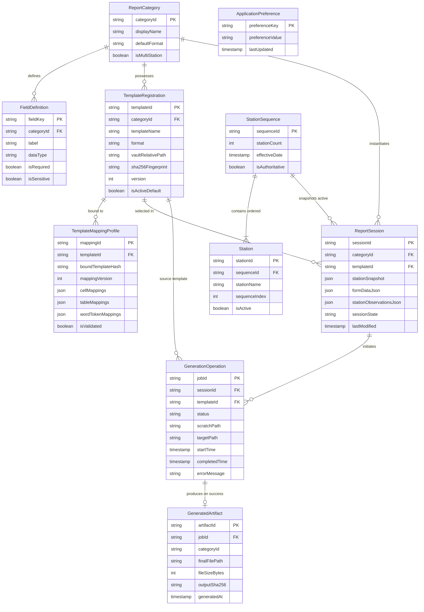

# OpsReport Studio — Conceptual Data Model Specification

**Document Identifier:** DATA-MODEL-SPEC-001  
**Project ID:** stationops-reporter  
**Approved Product Name:** OpsReport Studio  
**Lifecycle Step:** Step 8 of 45 (Local Data Model, File Storage Strategy & Project Structure Design)  
**Status:** Authoritative Conceptual Data Model Specification  
**Last Updated:** 2026-10-19  

> [!IMPORTANT]
> **SPECIFICATION AND DESIGN DOCUMENT ONLY — NOT A DATABASE IMPLEMENTATION**  
> This document defines the conceptual data model, entity relationships, integrity constraints, and domain boundaries for OpsReport Studio. It does NOT create SQL tables, ORM models, migration scripts, or production code. Those activities remain strictly assigned to later implementation steps.

---

## 1. Data Ownership Principles

OpsReport Studio manages operational information across multiple distinct forms: physical Office documents, relational database rows, serialized form state drafts, and local filesystem artifacts. 

To eliminate data corruption, split-brain state, and architectural confusion, the following **authoritative data ownership principles** are established:

### 1.1 Master-Template Files vs. Database Records
* **The Master Document File is the Authoritative Source for Layout & Styling:** The physical Open XML file (`.xlsx` or `.docx`) residing in the Template Vault is the sole authoritative definition of cell formatting, font styling, merged ranges, print areas, header logos, and Word paragraph layouts.
* **Database Records are Descriptive Metadata:** The `Template` database record identifies the file, registers its business category, records its cryptographic SHA-256 fingerprint, and tracks its revision. A database record must **never** be treated as a substitute for the physical document file.
* **Separation of Filesystem and State:** If a master template file is missing or corrupted on disk, the database record cannot "reconstruct" the template. The system must report an explicit missing-asset error (`ERR-TPL-FILE-MISSING`).

### 1.2 Template Mapping Configuration vs. Physical Templates
* **Mappings are Abstract Relation Layers:** A `TemplateMappingProfile` describes how abstract business field keys (e.g., `FLD-INC-DATE`, `FLD-STN-LIGHT`) correspond to physical coordinates (e.g., `Sheet1!C4` or `{{incident_date}}`).
* **Mappings Belong to Template Revisions:** A mapping profile is bound to a specific cryptographic fingerprint of a master template. A template update that alters cell coordinates or token names requires a new or updated mapping profile (`DEC-025`).

### 1.3 Authoritative Station Configuration
* **Single Source of Station Truth:** The `StationSequence` entity in the local database is the single authoritative source of truth for valid station identities, display names, and strict sequential ordering ($1, 2, \dots, N$) (`REQ-008`).
* **Prohibition on Private Lists:** Report forms, template generators, and document-processing modules must **never** maintain independent, hardcoded, or private station lists. All workflows consume the authoritative sequence from the domain service.

### 1.4 Report Definitions & Fields vs. Document Coordinates
* **Report Definitions Represent Business Semantics:** A `ReportCategory` and its `FieldDefinition` set describe what operational data is required, field data types, allowed values, validation boundaries, and conditional requirements.
* **Coordinate Independence:** Report definitions know nothing about spreadsheet cell coordinates (`B14`) or Word placeholder syntax (`{{token}}`). Field definitions remain 100% decoupled from document layouts.

### 1.5 Report-Session Data (Drafts) vs. Completed Reports
* **Drafts are Mutable In-Progress Working States:** Unfinished form inputs entered by an operator are persisted in `ReportSession` / `ReportDraft` records to ensure recovery after unexpected shutdowns (`OPT-002`).
* **Completed Reports are Immutable Output Artifacts:** Once a report is generated, verified, and exported to the user's destination folder, it becomes an independent external document. The database records a summary audit entry in `GenerationOperation` / `GeneratedArtifact`, but the report content belongs to the host filesystem.

### 1.6 Application Preferences
* **Preferences are Non-Operational State:** User interface theme selections (`'light'` vs `'dark'`), window positions, and default export paths belong to `ApplicationPreference`. They are segregated from operational report data and template configurations.

---

## 2. Core Conceptual Entities

The conceptual data model comprises 10 primary entities, each classified by evidence origin:

| Entity Name | Conceptual Purpose | Evidence Classification | Primary Requirements Reference |
| :--- | :--- | :--- | :--- |
| **`Station`** | Represents an operational facility location referenced in inspection reports. | Confirmed (Step 1, Step 3) | `REQ-008`, `INV-STN-001`–`007` |
| **`StationSequence`** | The ordered operational baseline enforcing strict 1..N station sequence. | Confirmed (Step 3) | `REQ-008`, `DEC-025` |
| **`ReportCategory`** | Identifies one of the 7 supported operational reporting categories. | Confirmed (Step 1, Step 2) | `REQ-001`, `RPT-CAT-001` |
| **`FieldDefinition`** | Abstract operational data field with data types and validation rules. | Confirmed (Step 2) | `REQ-007`, `REQ-012`, `FLD-DIC-001` |
| **`TemplateRegistration`**| Managed record of an approved, reusable `.xlsx` or `.docx` master template. | Confirmed (Step 1, Step 4) | `REQ-004`, `REQ-006`, `TPL-SEC-001` |
| **`TemplateMappingProfile`**| Associates business fields with physical workbook cells or Word tokens. | Confirmed (Step 1, Step 4) | `REQ-009`, `MAP-ENG-001` |
| **`ReportSession` (Draft)**| Work-in-progress operational report data entered by an operator. | Confirmed (Step 1, Step 6) | `REQ-007`, `OPT-002` |
| **`GenerationOperation`**| Execution tracking record of a document generation attempt. | Confirmed (Step 6) | `REQ-005`, `NFR-REL-02`, `DEC-023` |
| **`GeneratedArtifact`** | Metadata record referencing a successfully finalized output report file. | Confirmed (Step 6) | `REQ-005`, `REQ-006` |
| **`ApplicationPreference`**| Local non-sensitive user settings (theme, export folder, collision rule). | Confirmed (Step 1, Step 6) | `REQ-011`, `DEC-021` |

---

## 3. Entity Definitions & Conceptual Attributes

```
┌────────────────────────────────────────────────────────────────────────┐
│ LEGEND FOR ATTRIBUTE CLASSIFICATION:                                   │
│ • [CONFIRMED] : Explicit user requirement or approved Step 1-7 decision│
│ • [PROVISIONAL]: Recommended architectural attribute pending Step 9-14 │
└────────────────────────────────────────────────────────────────────────┘
```

### 3.1 Entity: `Station`
* **Purpose:** Represents an individual station or facility node within the transportation or facility network.
* **Conceptual Attributes:**
  * `stationId`: String [CONFIRMED] — Unique stable identifier (e.g., `"STN-001"`).
  * `stationName`: String [CONFIRMED] — Official display name (e.g., `"Grand Central Concourse"`).
  * `officialCode`: String [PROVISIONAL] — Optional operational code (e.g., `"GCC-01"`).
  * `sequenceIndex`: Integer [CONFIRMED] — Authoritative 1-based sequential position ($1 \le i \le N$).
  * `isActive`: Boolean [CONFIRMED] — Indicates if station is currently active in the audit route.
  * `facilitySector`: String [PROVISIONAL] — Optional physical zone grouping.

### 3.2 Entity: `StationSequence`
* **Purpose:** Enforces the collective ordering integrity of the station list.
* **Conceptual Attributes:**
  * `sequenceId`: String [CONFIRMED] — Versioned identifier of the sequence baseline.
  * `stationCount`: Integer [CONFIRMED] — Total number of stations in the active sequence ($N$).
  * `effectiveDate`: Timestamp [CONFIRMED] — Date sequence was authorized.
  * `isAuthoritative`: Boolean [CONFIRMED] — True for the active operational sequence.

### 3.3 Entity: `ReportCategory`
* **Purpose:** Represents one of the 7 approved operational report categories.
* **Conceptual Attributes:**
  * `categoryId`: String [CONFIRMED] — Stable identifier (`'RPT-INCIDENT'`, `'RPT-STATION-LIGHT'`, `'RPT-FAN'`, `'RPT-POLE-LIGHT'`, `'RPT-FIRE-EXTINGUISHER'`, `'RPT-PILLAR'`, `'RPT-FENCE'`).
  * `displayName`: String [CONFIRMED] — Human-readable title (e.g., `"Station Lighting Inspection Report"`).
  * `defaultFormat`: String [CONFIRMED] — Primary format (`'EXCEL_XLSX'` or `'WORD_DOCX'`).
  * `isMultiStation`: Boolean [CONFIRMED] — True for multi-station audit reports (all except incident).
  * `description`: String [CONFIRMED] — Operational scope summary.

### 3.4 Entity: `FieldDefinition`
* **Purpose:** Describes an operational data field independently of document coordinates.
* **Conceptual Attributes:**
  * `fieldKey`: String [CONFIRMED] — Authoritative field identifier (e.g., `'FLD-INC-DATE'`, `'FLD-COM-INSPECTOR'`).
  * `categoryId`: String [CONFIRMED] — Parent category reference or `'COMMON'`.
  * `label`: String [CONFIRMED] — Form control display label (e.g., `"Inspection Date"`).
  * `dataType`: String [CONFIRMED] — `'STRING'`, `'INTEGER'`, `'DECIMAL'`, `'DATE'`, `'TIME'`, `'BOOLEAN'`, `'ENUM'`.
  * `isRequired`: Boolean [CONFIRMED] — Mandatory status.
  * `validationRules`: Object [CONFIRMED] — Regex, min/max length, numeric bounds.
  * `isSensitive`: Boolean [CONFIRMED] — True for confidential incident narratives, witness data, and badge numbers.

### 3.5 Entity: `TemplateRegistration`
* **Purpose:** Manages the registration, vault storage reference, and lifecycle of an approved master template.
* **Conceptual Attributes:**
  * `templateId`: String [CONFIRMED] — Unique UUIDv4.
  * `templateName`: String [CONFIRMED] — User-friendly display name.
  * `categoryId`: String [CONFIRMED] — Associated report category.
  * `format`: String [CONFIRMED] — `'EXCEL_XLSX'` or `'WORD_DOCX'`.
  * `vaultRelativePath`: String [CONFIRMED] — Relative path within `%LOCALAPPDATA%\OpsReportStudio\Templates\`.
  * `sha256Fingerprint`: String [CONFIRMED] — Cryptographic hash computed upon ingestion.
  * `version`: Integer [CONFIRMED] — Monotonically increasing revision counter.
  * `isActiveDefault`: Boolean [CONFIRMED] — Designates the active default template for the category.
  * `createdAt`: Timestamp [CONFIRMED] — Ingestion timestamp.
  * `status`: String [CONFIRMED] — `'ACTIVE'`, `'DEPRECATED'`, `'QUARANTINED'`.

### 3.6 Entity: `TemplateMappingProfile`
* **Purpose:** Maps business fields to physical cell coordinates or Word tokens for a specific template.
* **Conceptual Attributes:**
  * `mappingId`: String [CONFIRMED] — Unique UUIDv4.
  * `templateId`: String [CONFIRMED] — Bound template reference.
  * `boundTemplateHash`: String [CONFIRMED] — Cryptographic SHA-256 hash of the template at mapping time.
  * `mappingVersion`: Integer [CONFIRMED] — Revision of the mapping configuration.
  * `cellMappings`: Array [CONFIRMED] — List of `{ fieldKey, sheetName, cellCoordinate, format }`.
  * `tableMappings`: Object [CONFIRMED] — Station table loop configuration `{ sheetName, startRow, columnMap }`.
  * `wordTokenMappings`: Array [CONFIRMED] — List of `{ fieldKey, tokenPlaceholder }`.
  * `isValidated`: Boolean [CONFIRMED] — Integrity status against template structure.

### 3.7 Entity: `ReportSession` (Draft)
* **Purpose:** Persists work-in-progress form data to prevent loss during unexpected terminations.
* **Conceptual Attributes:**
  * `sessionId`: String [CONFIRMED] — Unique UUIDv4.
  * `categoryId`: String [CONFIRMED] — Category being drafted.
  * `templateId`: String [CONFIRMED] — Selected template reference.
  * `stationSnapshot`: JSON [CONFIRMED] — Frozen station list snapshot (`DEC-025`).
  * `formDataJson`: JSON [CONFIRMED] — Serialized key-value form inputs.
  * `stationObservationsJson`: JSON [CONFIRMED] — Serialized multi-station observation rows.
  * `sessionState`: String [CONFIRMED] — `'EDITING'`, `'VALIDATED'`, `'GENERATING'`, `'EXPORTED'`.
  * `lastModified`: Timestamp [CONFIRMED] — ISO-8601 UTC timestamp.

### 3.8 Entity: `GenerationOperation`
* **Purpose:** Represents a concrete document compilation and export attempt (`DEC-023`).
* **Conceptual Attributes:**
  * `jobId`: String [CONFIRMED] — Unique UUIDv4 job token.
  * `sessionId`: String [CONFIRMED] — Source draft reference.
  * `templateId`: String [CONFIRMED] — Master template used.
  * `status`: String [CONFIRMED] — `'PENDING'`, `'PROCESSING'`, `'COMPLETED'`, `'FAILED'`, `'INTERRUPTED'`.
  * `scratchPath`: String [CONFIRMED] — Ephemeral working file location.
  * `targetPath`: String [CONFIRMED] — Final export destination on disk.
  * `startTime`: Timestamp [CONFIRMED] — Execution start.
  * `completedTime`: Timestamp [CONFIRMED] — Execution end.
  * `errorMessage`: String [CONFIRMED] — Sanitized diagnostic message on failure.

### 3.9 Entity: `GeneratedArtifact`
* **Purpose:** Metadata record referencing a successfully finalized output report on the host filesystem.
* **Conceptual Attributes:**
  * `artifactId`: String [CONFIRMED] — Unique UUIDv4.
  * `jobId`: String [CONFIRMED] — Generation operation reference.
  * `categoryId`: String [CONFIRMED] — Report category.
  * `finalFilePath`: String [CONFIRMED] — Full absolute path on host filesystem.
  * `fileSizeBytes`: Integer [CONFIRMED] — Output size in bytes.
  * `outputSha256`: String [CONFIRMED] — Checksum of finalized document.
  * `generatedAt`: Timestamp [CONFIRMED] — Finalization timestamp.

### 3.10 Entity: `ApplicationPreference`
* **Purpose:** Persists non-operational user preferences.
* **Conceptual Attributes:**
  * `preferenceKey`: String [CONFIRMED] — Key name (`'theme'`, `'defaultExportFolder'`, `'collisionPolicy'`).
  * `preferenceValue`: String [CONFIRMED] — Stored value string.
  * `lastUpdated`: Timestamp [CONFIRMED] — Update timestamp.

---

## 4. Mermaid Conceptual Data Model Diagram



---

## 5. Conceptual Integrity Invariants & Constraints

The data model enforces 8 fundamental integrity invariants:

1. **`INV-DAT-001` (Master Vault File Coherence):** A `TemplateRegistration` record must never point to a non-existent or corrupted file. The physical file referenced by `vaultRelativePath` must exist on disk and its real-time SHA-256 hash must match `sha256Fingerprint`.
2. **`INV-DAT-002` (Mapping Hash Binding):** A `TemplateMappingProfile` is valid only if its `boundTemplateHash` equals the current `sha256Fingerprint` of its parent `TemplateRegistration`. If the template file changes, the mapping transitions to `MAP_DRIFT_DETECTED` (`DEC-025`).
3. **`INV-DAT-003` (Strict Station Ordinality):** The `Station` collection belonging to the authoritative `StationSequence` must have contiguous `sequenceIndex` values from $1$ to $N$ with zero duplicate indexes and zero sequence gaps (`REQ-008`).
4. **`INV-DAT-004` (Draft Station Insulation):** Once created, a `ReportSession` retains an immutable `stationSnapshot`. Subsequent changes to the master `Station` table do not alter in-progress session data.
5. **`INV-DAT-005` (Two-Phase Generation Reservation):** A `GenerationOperation` must be committed to the database in `PENDING` state before any scratch file is created or mutated. It transitions to `COMPLETED` only after the file is successfully validated in the target export folder (`DEC-023`).
6. **`INV-DAT-006` (Master Template Immutability at Storage Layer):** No entity, query, or operation may store a target path that resolves to `%LOCALAPPDATA%\OpsReportStudio\Templates\`. Master templates are strictly immutable (`REQ-006`).
7. **`INV-DAT-007` (Non-Destructive Metadata Retirement):** Retiring or deleting a `TemplateRegistration` or `ReportCategory` record must **never** trigger cascading file deletion of previously generated reports or original master templates.
8. **`INV-DAT-008` (Zero Sensitive Data in Preferences):** `ApplicationPreference` is restricted to non-sensitive UI settings. Confidential incident narratives, witness data, and credentials must never be stored in user preferences.

---

## 6. Unresolved Data Decisions Requiring Operational Confirmation

1. **Official Station Names & Facility Identifiers:** Exact station names and physical codes await delivery from operational facility management. The data model supports arbitrary $N$ stations with 1..N ordinality.
2. **Physical Master Template Inventory:** Production templates await client delivery; synthetic structures are currently modeled.
3. **Draft Retention & Pruning Horizon:** Recommended default auto-prunes drafts older than 30 days; client confirmation is pending.
