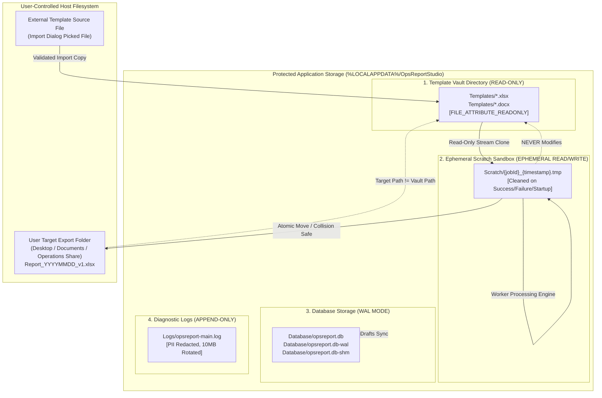

# OpsReport Studio — Local File Storage & Architecture Specification

**Document Identifier:** FILE-STORAGE-SPEC-001  
**Project ID:** stationops-reporter  
**Approved Product Name:** OpsReport Studio  
**Lifecycle Step:** Step 8 of 45 (Local Data Model, File Storage Strategy & Project Structure Design)  
**Status:** Authoritative Local Storage Specification  
**Last Updated:** 2026-10-19  

> [!IMPORTANT]
> **STORAGE STRATEGY SPECIFICATION ONLY — NOT FILE SYSTEM IMPLEMENTATION**  
> This document specifies the logical directories, file classes, access boundaries, collision rules, and cleanup protocols. It does NOT create folders or alter filesystem permissions on the host.

---

## 1. Storage Architecture Overview

OpsReport Studio establishes a strict, air-gapped local storage layout on Windows 10/11 operator consoles (`NFR-COMP-01`, `NFR-SEC-01`). The architecture cleanly segregates:
1. **Read-Only Master Templates** (Protected Application Vault).
2. **Ephemeral Disposable Scratch Files** (Isolated Processing Sandbox).
3. **Structured Application Metadata** (Embedded SQLite Database).
4. **User-Selected Export Targets** (Host User Directories).
5. **Sanitized Diagnostic Traces** (Local Append-Only Logs).

---

## 2. Mermaid Storage Layout Diagram



---

## 3. Storage Zone Specifications

### 3.1 Zone 1: Master-Template Vault (`%LOCALAPPDATA%\OpsReportStudio\Templates\`)
* **Purpose:** Serves as the authoritative, tamper-resistant store for approved Excel (`.xlsx`) and Word (`.docx`) master templates (`REQ-004`, `REQ-006`).
* **Storage Convention:** Files are named using their unique UUIDv4 identifier: `{templateId}.{xlsx|docx}` to prevent filename collisions and path traversal attacks.
* **Security & Immutability Enforcement:**
  1. Operating system file attribute `FILE_ATTRIBUTE_READONLY` is set upon import.
  2. Document generation pipelines open vault files strictly with OS sharing flags: `FileShare.Read`.
  3. No application module is permitted to open a vault file with write flags (`w`, `w+`, `r+`).
  4. Cryptographic SHA-256 fingerprint is verified before every read operation.

### 3.2 Zone 2: Ephemeral Scratch Sandbox (`%LOCALAPPDATA%\OpsReportStudio\Scratch\`)
* **Purpose:** Houses temporary working copies during document compilation (`REQ-005`, `NFR-REL-01`).
* **Naming Convention:** `{jobId}_{timestamp}.tmp`.
* **Lifecycle & Cleanup:**
  1. Cloned directly from the Vault before data injection.
  2. Mutated solely by the isolated Worker Thread (`MOD-08`).
  3. Validated for Open XML structural integrity.
  4. Automatically unlinked upon successful export, generation cancellation, worker error, or application startup sweep.

### 3.3 Zone 3: Embedded Database Storage (`%LOCALAPPDATA%\OpsReportStudio\Database\`)
* **Purpose:** Stores the single application database file: `opsreport.db`.
* **Runtime Engine:** `better-sqlite3` operating in Write-Ahead Logging mode (`PRAGMA journal_mode = WAL`).
* **Access Boundary:** Accessed exclusively by trusted main-process repositories (`MOD-09`). The renderer process has zero SQL execution capabilities.

### 3.4 Zone 4: Diagnostic Logs (`%LOCALAPPDATA%\OpsReportStudio\Logs\`)
* **Purpose:** Stores technical diagnostic traces and operational error records (`MOD-12`).
* **Rotation Policy:** Single file size ceiling of 10 MB, rotating a maximum of 3 archived files (`opsreport-main.1.log`, `opsreport-main.2.log`).
* **PII Redaction Interceptor:** All logging calls automatically redact incident narratives (`FLD-INC-NARRATIVE`), witness statements, inspector names, and badge numbers (`DEC-024`).

### 3.5 Zone 5: User-Selected Output Folders
* **Purpose:** Final destination for completed, verified operational reports (`REQ-005`).
* **Ownership:** The host user and operating system own exported files once finalized.
* **Collision Policy (`DEC-021`):** Default policy is **Safe Auto-Incrementation** (`RENAME_SAFE`). If `StationLight_Audit.xlsx` exists, the exporter generates `StationLight_Audit_v2.xlsx` to prevent silent overwrites.

---

## 4. File Ownership & Permissions Matrix

The following matrix defines the authoritative lifecycle rules across 10 conceptual file classes:

| File Class ID | File Classification | Authoritative Location | Owning Module | Read Allowed | Write / Delete Allowed | Sensitive Content? | Consistency Verification |
| :--- | :--- | :--- | :--- | :--- | :--- | :--- | :--- |
| **FC-01** | **Original Master Template** | External user folder | User / OS | `MOD-06` (Ingestion) | User only (App never writes) | Low | Read-only stream check |
| **FC-02** | **Candidate Ingestion Buffer**| In-memory buffer | `MOD-06` | `MOD-06` | `MOD-06` | Low | Zip bomb/slip validation |
| **FC-03** | **Vault Master Template** | `%LOCALAPPDATA%\Templates\` | `MOD-10` (Vault) | `MOD-10`, `MOD-08` | `MOD-10` (Import only; NO in-place edits) | Low | SHA-256 fingerprint check |
| **FC-04** | **Ephemeral Scratch Copy** | `%LOCALAPPDATA%\Scratch\` | `MOD-10` / `MOD-08`| `MOD-08` (Worker) | `MOD-08` (Write), `MOD-10` (Delete) | Medium (Report data) | Path divergence check |
| **FC-05** | **Final Generated Report** | User target directory | User / OS | User / OS | `MOD-10` (Atomic move on finalize) | High (Full report) | Size & ZIP header check |
| **FC-06** | **Incomplete/Failed Artifact**| `%LOCALAPPDATA%\Scratch\` | `MOD-10` | None | `MOD-10` (Immediate purge) | Medium | Immediate unlink |
| **FC-07** | **Authoritative Station Config**| `opsreport.db` (`stations`) | `MOD-04` / `MOD-09`| `MOD-02`, `MOD-04` | `MOD-04` (Admin updates only) | Low | 1..N ordinality invariant |
| **FC-08** | **Application Database** | `%LOCALAPPDATA%\Database\` | `MOD-09` | `MOD-09` | `MOD-09` | Medium (Draft data)| SQLite `quick_check` |
| **FC-09** | **Diagnostic Log Files** | `%LOCALAPPDATA%\Logs\` | `MOD-12` | Main Process | `MOD-12` (Append/Rotate) | Low (Sanitized) | Redaction filter active |
| **FC-10** | **Template Vault Backup** | Optional backup folder | `MOD-10` | Admin / User | `MOD-10` (Scheduled backup) | Low | Checksum comparison |

---

## 5. Filesystem Safety & Path Traversal Guards

All paths crossing module or process boundaries are canonicalized and guarded by `MOD-10`:

```typescript
// Conceptual path guard implementation specification
export class PathSecurityGuard {
  public static validateExportTarget(targetPath: string, masterTemplatePath: string): string {
    const resolvedTarget = path.resolve(targetPath);
    const resolvedMaster = path.resolve(masterTemplatePath);

    // Guard 1: Master Immutability Assertion
    if (resolvedTarget.toLowerCase() === resolvedMaster.toLowerCase()) {
      throw new SecurityError("ERR-SEC-TARGET-IS-MASTER: Target destination cannot overwrite the master template.");
    }

    // Guard 2: Prevent Writing to Template Vault
    const vaultDir = path.resolve(getTemplateVaultDirectory());
    if (resolvedTarget.toLowerCase().startsWith(vaultDir.toLowerCase())) {
      throw new SecurityError("ERR-SEC-VAULT-WRITE: Writing directly into Template Vault is strictly prohibited.");
    }

    // Guard 3: Prevent System Directory Overwrites
    const systemRoot = process.env.SystemRoot || 'C:\\Windows';
    if (resolvedTarget.toLowerCase().startsWith(systemRoot.toLowerCase())) {
      throw new SecurityError("ERR-SEC-SYSTEM-DIR: Writing to operating system directories is prohibited.");
    }

    // Guard 4: Prohibit Null-Byte and Traversal Sequences
    if (targetPath.includes('\0') || targetPath.includes('..')) {
      throw new SecurityError("ERR-SEC-PATH-TRAVERSAL: Invalid path characters detected.");
    }

    return resolvedTarget;
  }
}
```

---

## 6. Output Destination Collision Policy (`DEC-021`)

When finalizing a report into the user's export folder, the system applies the following deterministic collision resolution:

```
Target File Exists?
       │
       ├── NO  ──> Atomic Move from Scratch to Target File
       │
       └── YES ──> Check Application Collision Setting:
                     │
                     ├── RENAME_SAFE (Default):
                     │     Loop: target_v2.xlsx, target_v3.xlsx until available
                     │     Atomic Move to unique incremented filename
                     │     Notify operator: "Saved as [Filename]_v2.xlsx"
                     │
                     └── PROMPT_USER:
                           Prompt operator: [Overwrite] or [Save As New]
                           If Overwrite confirmed: Atomic replace
                           If Cancelled: Keep scratch; prompt new folder
```

---

## 7. Crash Recovery & Ephemeral File Cleanup

OpsReport Studio enforces an **automated startup sweep**:
1. Upon application launch, `MOD-10` scans `%LOCALAPPDATA%\OpsReportStudio\Scratch\`.
2. Any temporary files (`*.tmp`) with creation timestamps older than 15 minutes indicate an abnormal shutdown (e.g., power loss, system crash).
3. The startup sweep securely unlinks all orphaned temporary files.
4. `MOD-09` scans `generation_history` in SQLite; any operations stuck in `PENDING` are reconciled to `INTERRUPTED`.

---

## 8. Backup & Retention Decisions

1. **Master Template Vault Backup (`DEC-018`):** The application architecture provides an exportable ZIP backup utility for the Template Vault. Automatic background replication to a network share remains provisional pending client operational approval.
2. **Draft Session Retention:** Unfinished drafts older than 30 days are flagged for operator purging during startup checks.
