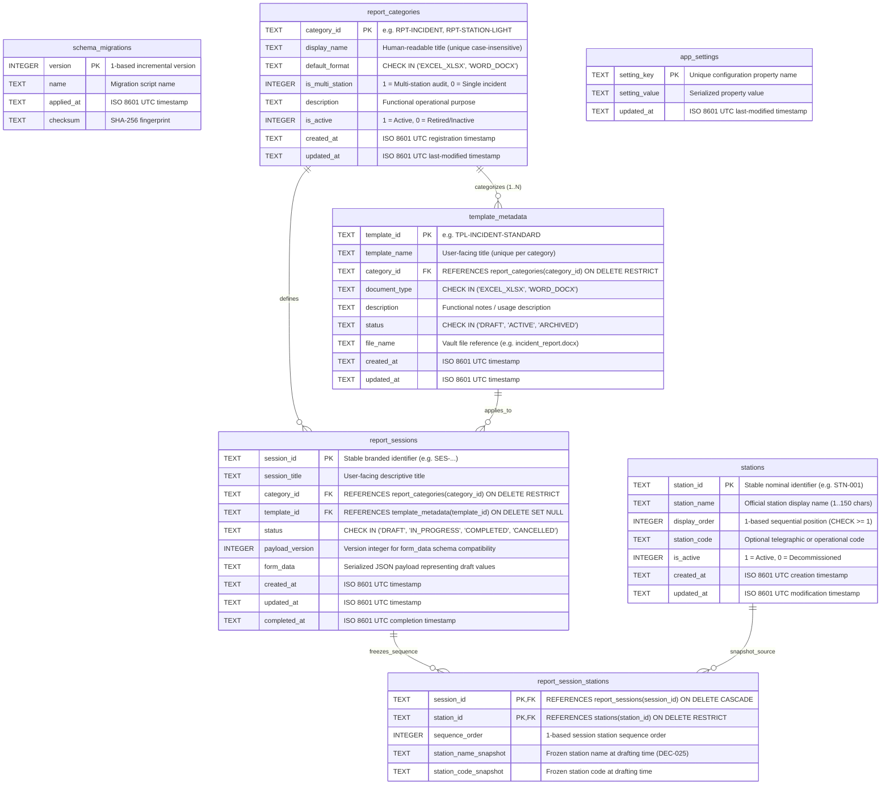

# OpsReport Studio — Local Database Schema Specification

**Document Identifier:** DB-SCHEMA-001  
**Project ID:** stationops-reporter  
**Approved Product Name:** OpsReport Studio  
**Lifecycle Step:** Step 16 of 45 (Report Session Data Model, Draft Persistence & Recovery Foundation)  
**Status:** Authoritative Implemented Schema Specification  
**Last Updated:** 2026-10-20  

---

## 1. Overview & Architectural Role

This document defines the physical SQLite schema implemented in OpsReport Studio. The local database (`opsreport.db`) provides structured local persistence for the station sequence, report categories, reusable template metadata descriptors, report sessions, incomplete draft payloads, frozen station sequence snapshots, and application configuration without embedding Office files or report documents directly into SQL tables.

### Key Operational Characteristics
* **Embedded Relational Engine:** SQLite 3 (via `better-sqlite3` v13 synchronous bindings).
* **Storage Location:** `%LOCALAPPDATA%\OpsReportStudio\Database\opsreport.db` (Windows standard).
* **Concurrency Model:** Write-Ahead Logging (`PRAGMA journal_mode = WAL`) allowing concurrent non-blocking reads during writes.
* **Schema Version Tracking:** Synchronized across `PRAGMA user_version` and the `schema_migrations` audit table.
* **Current Schema Version:** `3` (Migration `003_report_session_and_draft_persistence`).

---

## 2. Entity-Relationship Diagram (Implemented Schema)



---

## 3. Physical Table Definitions & Data Dictionaries

### 3.1 Table: `schema_migrations`
Tracks versioned migration history.

```sql
CREATE TABLE IF NOT EXISTS schema_migrations (
  version INTEGER PRIMARY KEY,
  name TEXT NOT NULL,
  applied_at TEXT NOT NULL,
  checksum TEXT NOT NULL
);
```

| Column | Type | Constraints | Description |
| :--- | :--- | :--- | :--- |
| `version` | `INTEGER` | `PRIMARY KEY` | Incremental integer schema version. Matches `PRAGMA user_version`. |
| `name` | `TEXT` | `NOT NULL` | Semantic name of the migration (e.g., `001_initial_schema`, `002_category_lifecycle_and_template_metadata`). |
| `applied_at` | `TEXT` | `NOT NULL` | ISO 8601 UTC timestamp of execution. |
| `checksum` | `TEXT` | `NOT NULL` | SHA-256 hash of the migration definition payload. |

---

### 3.2 Table: `report_categories`
Stores the authoritative reference catalog of operational reporting categories.

```sql
CREATE TABLE IF NOT EXISTS report_categories (
  category_id TEXT PRIMARY KEY,
  display_name TEXT NOT NULL,
  default_format TEXT NOT NULL CHECK(default_format IN ('EXCEL_XLSX', 'WORD_DOCX')),
  is_multi_station INTEGER NOT NULL DEFAULT 1 CHECK(is_multi_station IN (0, 1)),
  description TEXT NOT NULL,
  is_active INTEGER NOT NULL DEFAULT 1,
  created_at TEXT NOT NULL,
  updated_at TEXT
);

CREATE INDEX IF NOT EXISTS idx_categories_active ON report_categories(is_active);
```

| Column | Type | Constraints | Description |
| :--- | :--- | :--- | :--- |
| `category_id` | `TEXT` | `PRIMARY KEY` | Stable branded identifier (e.g., `'RPT-INCIDENT'`). |
| `display_name` | `TEXT` | `NOT NULL` | Human-readable title displayed on dashboard and selection views. |
| `default_format` | `TEXT` | `NOT NULL, CHECK` | Master template document type (`'EXCEL_XLSX'` or `'WORD_DOCX'`). |
| `is_multi_station`| `INTEGER` | `DEFAULT 1, CHECK` | Whether report collects row data across all ordered stations. |
| `description` | `TEXT` | `NOT NULL` | Operational description of the report's purpose. |
| `is_active` | `INTEGER` | `DEFAULT 1, NOT NULL` | Active status (1 = Active, 0 = Deactivated/Retired). |
| `created_at` | `TEXT` | `NOT NULL` | ISO 8601 UTC creation timestamp. |
| `updated_at` | `TEXT` | `NOT NULL` | ISO 8601 UTC modification timestamp. |

#### Seeded Reference Records (7 Categories):
1. `'RPT-INCIDENT'`: "Security Incident Reports" (`WORD_DOCX`, Single Incident, `is_multi_station = 0`)
2. `'RPT-STATION-LIGHT'`: "Station Light Reports" (`EXCEL_XLSX`, Multi-Station, `is_multi_station = 1`)
3. `'RPT-FAN'`: "Fan Reports" (`EXCEL_XLSX`, Multi-Station, `is_multi_station = 1`)
4. `'RPT-POLE-LIGHT'`: "Pole Light Reports" (`EXCEL_XLSX`, Multi-Station, `is_multi_station = 1`)
5. `'RPT-FIRE-EXTINGUISHER'`: "Fire Extinguisher Reports" (`EXCEL_XLSX`, Multi-Station, `is_multi_station = 1`)
6. `'RPT-PILLAR'`: "Pillar Reports" (`EXCEL_XLSX`, Multi-Station, `is_multi_station = 1`)
7. `'RPT-FENCE'`: "Fence Reports" (`EXCEL_XLSX`, Multi-Station, `is_multi_station = 1`)

---

### 3.3 Table: `template_metadata`
Stores metadata descriptors for reusable report templates and binds them to operational report categories.

```sql
CREATE TABLE IF NOT EXISTS template_metadata (
  template_id TEXT PRIMARY KEY,
  template_name TEXT NOT NULL CHECK(length(trim(template_name)) > 0),
  category_id TEXT NOT NULL REFERENCES report_categories(category_id) ON UPDATE CASCADE ON DELETE RESTRICT,
  document_type TEXT NOT NULL CHECK(document_type IN ('EXCEL_XLSX', 'WORD_DOCX')),
  description TEXT,
  status TEXT NOT NULL DEFAULT 'ACTIVE' CHECK(status IN ('DRAFT', 'ACTIVE', 'ARCHIVED')),
  file_name TEXT,
  created_at TEXT NOT NULL,
  updated_at TEXT NOT NULL
);

CREATE INDEX IF NOT EXISTS idx_template_category ON template_metadata(category_id);
CREATE INDEX IF NOT EXISTS idx_template_status ON template_metadata(status);
```

| Column | Type | Constraints | Description |
| :--- | :--- | :--- | :--- |
| `template_id` | `TEXT` | `PRIMARY KEY` | Stable branded identifier (e.g., `'TPL-INCIDENT-STANDARD'`). |
| `template_name` | `TEXT` | `NOT NULL, CHECK` | User-facing title. Uniqueness enforced per category. |
| `category_id` | `TEXT` | `NOT NULL, FK` | Foreign key referencing `report_categories(category_id)`. Deletion restricted. |
| `document_type` | `TEXT` | `NOT NULL, CHECK` | Open XML format (`'EXCEL_XLSX'` or `'WORD_DOCX'`). |
| `description` | `TEXT` | `NULLABLE` | Functional notes or usage guidance. |
| `status` | `TEXT` | `DEFAULT 'ACTIVE', CHECK` | Lifecycle status (`'DRAFT'`, `'ACTIVE'`, `'ARCHIVED'`). |
| `file_name` | `TEXT` | `NULLABLE` | Master template file reference in vault. |
| `created_at` | `TEXT` | `NOT NULL` | ISO 8601 UTC creation timestamp. |
| `updated_at` | `TEXT` | `NOT NULL` | ISO 8601 UTC modification timestamp. |

---

### 3.4 Table: `stations`
Stores the authoritative sequence of station and facility nodes.

```sql
CREATE TABLE IF NOT EXISTS stations (
  station_id TEXT PRIMARY KEY,
  station_name TEXT NOT NULL,
  display_order INTEGER NOT NULL CHECK(display_order >= 1),
  station_code TEXT,
  is_active INTEGER NOT NULL DEFAULT 1 CHECK(is_active IN (0, 1)),
  created_at TEXT NOT NULL,
  updated_at TEXT NOT NULL
);

CREATE INDEX IF NOT EXISTS idx_stations_order ON stations(display_order ASC);
CREATE INDEX IF NOT EXISTS idx_stations_active ON stations(is_active);
```

| Column | Type | Constraints | Description |
| :--- | :--- | :--- | :--- |
| `station_id` | `TEXT` | `PRIMARY KEY` | Stable nominal identifier (e.g., `'STN-001'` or UUID). |
| `station_name` | `TEXT` | `NOT NULL` | Official human-readable station name (1..150 characters). |
| `display_order` | `INTEGER` | `NOT NULL, CHECK >= 1`| Explicit 1-based ordinal sequence position (`REQ-008`). |
| `station_code` | `TEXT` | `NULLABLE` | Optional operational or telegraphic shortcode. |
| `is_active` | `INTEGER` | `DEFAULT 1, CHECK` | Operational status (1 = Active, 0 = Decommissioned). |
| `created_at` | `TEXT` | `NOT NULL` | ISO 8601 UTC timestamp. |
| `updated_at` | `TEXT` | `NOT NULL` | ISO 8601 UTC timestamp. |

---

### 3.5 Table: `report_sessions`
Persistent table for report drafting sessions, lifecycle status, dynamic payload JSON, and timestamps.

```sql
CREATE TABLE IF NOT EXISTS report_sessions (
  session_id TEXT PRIMARY KEY,
  session_title TEXT NOT NULL CHECK(length(trim(session_title)) > 0),
  category_id TEXT NOT NULL REFERENCES report_categories(category_id) ON UPDATE CASCADE ON DELETE RESTRICT,
  template_id TEXT REFERENCES template_metadata(template_id) ON UPDATE CASCADE ON DELETE SET NULL,
  status TEXT NOT NULL DEFAULT 'DRAFT' CHECK(status IN ('DRAFT', 'IN_PROGRESS', 'COMPLETED', 'CANCELLED')),
  payload_version INTEGER NOT NULL DEFAULT 1,
  form_data TEXT NOT NULL DEFAULT '{}',
  created_at TEXT NOT NULL,
  updated_at TEXT NOT NULL,
  completed_at TEXT
);

CREATE INDEX IF NOT EXISTS idx_sessions_status ON report_sessions(status);
CREATE INDEX IF NOT EXISTS idx_sessions_category ON report_sessions(category_id);
CREATE INDEX IF NOT EXISTS idx_sessions_updated ON report_sessions(updated_at DESC);
```

| Column | Type | Constraints | Description |
| :--- | :--- | :--- | :--- |
| `session_id` | `TEXT` | `PRIMARY KEY` | Stable branded session identifier (`ReportSessionId`). |
| `session_title` | `TEXT` | `NOT NULL, CHECK > 0` | User-facing descriptive session title. |
| `category_id` | `TEXT` | `NOT NULL, FK RESTRICT` | Referenced report category (`ON DELETE RESTRICT`). |
| `template_id` | `TEXT` | `NULLABLE, FK SET NULL` | Referenced template metadata descriptor. |
| `status` | `TEXT` | `NOT NULL, CHECK` | Lifecycle state (`'DRAFT'`, `'IN_PROGRESS'`, `'COMPLETED'`, `'CANCELLED'`). |
| `payload_version` | `INTEGER` | `NOT NULL, DEFAULT 1` | Version integer for draft JSON schema compatibility. |
| `form_data` | `TEXT` | `NOT NULL, DEFAULT '{}'`| Serialized JSON payload containing category-specific draft values. |
| `created_at` | `TEXT` | `NOT NULL` | ISO 8601 UTC session creation timestamp. |
| `updated_at` | `TEXT` | `NOT NULL` | ISO 8601 UTC last modification timestamp. |
| `completed_at` | `TEXT` | `NULLABLE` | ISO 8601 UTC completion timestamp (null until completed). |

---

### 3.6 Table: `report_session_stations`
Junction table capturing an immutable frozen station sequence snapshot (`DEC-025`) associated with a session.

```sql
CREATE TABLE IF NOT EXISTS report_session_stations (
  session_id TEXT NOT NULL REFERENCES report_sessions(session_id) ON UPDATE CASCADE ON DELETE CASCADE,
  station_id TEXT NOT NULL REFERENCES stations(station_id) ON UPDATE CASCADE ON DELETE RESTRICT,
  sequence_order INTEGER NOT NULL CHECK(sequence_order >= 1),
  station_name_snapshot TEXT NOT NULL,
  station_code_snapshot TEXT,
  PRIMARY KEY (session_id, station_id)
);

CREATE INDEX IF NOT EXISTS idx_session_stations_seq ON report_session_stations(session_id, sequence_order ASC);
```

| Column | Type | Constraints | Description |
| :--- | :--- | :--- | :--- |
| `session_id` | `TEXT` | `PK, FK CASCADE` | Parent report session identifier. |
| `station_id` | `TEXT` | `PK, FK RESTRICT` | Canonical station identifier (`ON DELETE RESTRICT`). |
| `sequence_order` | `INTEGER` | `NOT NULL, CHECK >= 1` | 1-based station sequence within this report session. |
| `station_name_snapshot` | `TEXT` | `NOT NULL` | Station display name frozen at time of drafting. |
| `station_code_snapshot` | `TEXT` | `NULLABLE` | Station telegraphic/operational code frozen at drafting. |

---

### 3.7 Table: `app_settings`
General key-value store for application configuration and persistence.

```sql
CREATE TABLE IF NOT EXISTS app_settings (
  setting_key TEXT PRIMARY KEY,
  setting_value TEXT NOT NULL,
  updated_at TEXT NOT NULL
);
```

---

## 4. Deferred Future Entities

In strict accordance with roadmap boundaries:

| Planned Table Name | Planned Delivery Step | Justification for Deferral |
| :--- | :--- | :--- |
| `template_vault` | **Step 17** | Master template binary file vault, SHA-256 immutability verification, and storage paths. |
| `template_mappings` | **Step 22 & 23** | Visual Open XML cell coordinate and Word bookmark binding profiles. |
| `generation_history` | **Step 26 & 31** | Execution tracking for two-phase document compilation jobs. |
| `generated_artifacts` | **Step 20** | Metadata archive of exported completed Excel/Word documents. |

---

## 5. Data Integrity & Constraints Summary

1. **Foreign Key Integrity (`ON DELETE RESTRICT`):** `template_metadata` and `report_sessions` strictly reference `report_categories`. Deleting a category that is referenced by any template or session record is rejected by the database and repository.
2. **Station Snapshot Protection (`ON DELETE RESTRICT`):** Canonical stations referenced by active or saved session snapshots cannot be deleted; deactivation must be used instead to protect historical records.
3. **Historical Isolation (`DEC-025`):** Station ordering updates in the global station configuration do not mutate frozen `report_session_stations` records.
4. **Parameterized SQL:** All queries use `?` placeholders. Zero string concatenation of user-supplied values.
5. **Timestamp Standardization:** All timestamps are formatted as ISO 8601 UTC strings (`YYYY-MM-DDTHH:mm:ss.sssZ`).
