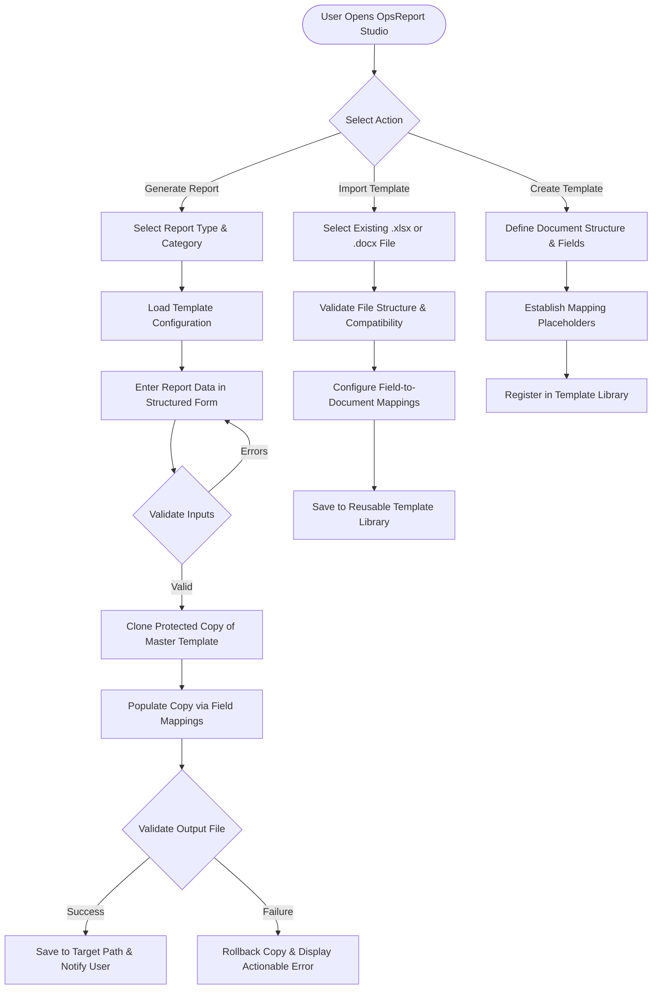

# OpsReport Studio — Product Requirements Baseline

**Document Identifier:** SRS-OPSREPORT-001  
**Project ID:** stationops-reporter  
**Approved Product Name:** OpsReport Studio  
**Project Type:** Desktop / Client Application  
**Initial Baseline Version:** 1.0.0-alpha (Provisional Baseline)  
**Lifecycle Step:** Step 1 of 45 (Requirements Baseline & Project Scope Definition)  
**Status:** Authoritative Baseline Draft  
**Last Updated:** 2026-10-19  

---

## 1. Project Identity & Governance

* **Approved Product Name:** OpsReport Studio
* **Project ID:** `stationops-reporter`
* **Project Category:** Productivity, Operations Reporting, Facility Inspection, Security & Incident Reporting, Document Automation
* **Primary Users:** Control room representatives, facility operations personnel, security officers, and field inspection coordinators
* **Current Lifecycle Phase:** Step 1 of 45 — Planning & Requirements Definition
* **Name Governance Rule:** Legacy or exploratory candidate names (including *StationOps Reporter* and *SentinelReport Pro*) are formally retired and shall not be used in code, UI, or documentation.

---

## 2. Executive Summary

OpsReport Studio is a specialized report-generation application designed to eliminate the repetitive, error-prone manual labor performed by control room representatives and facility inspectors. Control room operators frequently generate high-frequency operational reports—spanning security incidents, station lighting, ventilation/fan operations, pole lights, fire extinguishers, structural pillars, and perimeter fencing. 

Currently, operators must open base Microsoft Excel workbooks or Microsoft Word documents, manually reconstruct layouts, adjust cell formatting, copy-paste recurring categories, and manually re-enter station sequences. This manual workflow incurs substantial friction, increases the likelihood of typos in critical infrastructure names, invites data omission, and carries the perpetual risk of accidentally altering or corrupting master templates.

OpsReport Studio solves these challenges by establishing a structured, template-driven workflow. Operators interact with intuitive, validated data-entry forms rather than raw spreadsheets or word processor canvasses. The engine ingests user inputs, clones the designated master template into an isolated output file, populates mapped cells and document placeholders, and exports a pristine, production-ready document while guaranteeing that original master templates remain strictly read-only and unaltered.

---

## 3. Product Problem Statement

### 3.1 Context & Current Workflow
In routine 24/7 control room operations, representatives are mandated to submit standardized inspection and incident reports. The existing operational mechanism relies on manual editing of Microsoft Office documents (`.xlsx` and `.docx`):
1. The operator locates an existing template or a previously submitted report on a local disk or shared drive.
2. The operator opens the document directly inside Microsoft Excel or Word.
3. The operator attempts to clear old entries while preserving complex formulas, grid formatting, column widths, headers, and footers.
4. The operator enters new inspection findings station by station.
5. The operator performs a manual "Save As", which frequently fails due to accidental standard "Save" commands overwriting the source file.

### 3.2 Pain Points & Operational Hazards
* **Template Degradation & Overwrite Risk:** Overwriting master templates forces staff to restore previous backups, leading to inconsistent styling and broken cell formulas across shifts.
* **Repetitive Formatting Overhead:** Operators spend significant portions of their shifts aligning columns, re-applying table styles, and adjusting margins rather than focusing on inspection accuracy.
* **Inconsistent Station Sequencing & Typographical Errors:** Manual entry of facility and station names leads to spelling discrepancies, omissions, and out-of-order listings, impeding historical data aggregation and compliance audits.
* **Cognitive Load of Spreadsheet Interfaces:** Forcing an operator to navigate a sprawling 50-column spreadsheet increases cognitive fatigue and data-entry errors. A streamlined, form-based input interface is vastly superior for structured data collection.
* **Lack of Process Traceability:** Dispersed files lack central validation, making it difficult to verify whether mandatory fields (such as inspection timestamps, inspector IDs, or incident classifications) were properly completed prior to submission.

### 3.3 Target Operational Outcomes
* Standardize all report data collection through purpose-built, validated input forms.
* Guarantee 100% preservation of master templates through programmatic read-only isolation and copy-first file generation.
* Guarantee deterministic, ordered station listings across all inspection workflows.
* Enable operators to produce compliant, beautifully formatted `.xlsx` and `.docx` documents in seconds without manually touching raw workbook internals.

---

## 4. Product Vision & Scope Boundaries

### 4.1 Product Vision
OpsReport Studio empowers control room operators and facility teams to produce flawless, standardized operational reports with minimal friction through intelligent template management, structured data entry, and fail-safe document automation.

### 4.2 Core Product Objectives
1. **Reduce Repetitive Labor:** Eliminate manual document reconstruction and formatting overhead.
2. **Template Library Management:** Provide centralized registration, storage, and cataloging of approved Excel and Word master templates.
3. **Master Template Immutability:** Strictly safeguard original master templates; all generation operations must execute against ephemeral or dedicated output copies.
4. **Structured Form-Based Entry:** Replace raw workbook data-entry with validated, step-by-step UI forms.
5. **Deterministic Station Ordering:** Enforce predefined, ordered station selections to eliminate sequencing errors and omissions.
6. **Built-in Reusable Template Creation:** Provide in-app authoring capabilities so authorized users can establish new reusable report templates.
7. **Ergonomic, Accessible UI:** Deliver a responsive, modern interface with a native Dark/Light theme toggle to accommodate variable control room lighting conditions.
8. **Clear Validation & Diagnostic Feedback:** Offer real-time input validation and transparent, human-readable error reporting if generation fails.

### 4.3 In-Scope Boundaries (Initial Product Baseline)
* Template management for Microsoft Excel (`.xlsx`) and Microsoft Word (`.docx`).
* Dedicated report selection catalog organized by category.
* Structured data-entry forms corresponding to selected report types.
* Pre-ordered station selection mechanisms (authoritative station catalog integrated when supplied).
* Programmatic document population generating independent target files.
* Built-in template creation/configuration module for defining new reusable templates and field-to-document mappings.
* System theme switching (Dark Mode / Light Mode).
* Local file storage, export path selection, and file generation verification.

### 4.4 Out-of-Scope Boundaries (Strictly Excluded from V1)
To prevent scope creep and maintain software reliability, the following capabilities are explicitly excluded from the initial core baseline:
* **No Direct Full Spreadsheet/Word Suite Replacement:** The app will not embed a complete Excel workbook editing canvas (e.g., full formula bar, multi-sheet workbook ribbon) as its primary report-entry surface.
* **No Cloud SaaS or Multi-Tenant Hosting:** The application is architected as a secure client-side desktop tool; no cloud hosting infrastructure or multi-tenant database is included in V1.
* **No AI/LLM Generative Text Generation:** Initial release relies strictly on deterministic data validation and mapping.
* **No Video/CCTV Integration:** The app is not a surveillance platform or video management system.
* **No Direct Hardware IoT / Sensor Telemetry:** Sensor-based automatic log polling is out of scope.

---

## 5. Initially Identified Report Categories

The product scope addresses seven core operational report categories identified by control room operations:
1. **Security Incident Reports:** Documenting security events, unauthorized access, breaches, perimeter anomalies, personnel involvement, and immediate corrective actions.
2. **Station Light Reports:** Systematic inspection logs tracking operational, defective, flickering, or unpowered lighting fixtures across designated facility stations.
3. **Fan / Ventilation Reports:** Status audits of extraction fans, ventilation louvers, tunnel dampers, and air circulation units.
4. **Pole Light Reports:** Exterior, yard, perimeter, and parking pole lighting assessments.
5. **Fire Extinguisher Reports:** Life safety audits recording extinguisher serial numbers, pressure gauge readings, inspection tags, pin seals, and physical accessibility.
6. **Pillar Reports:** Structural integrity, signage, bumper protection, and surface defect logging across structural support pillars.
7. **Fence Reports:** Physical perimeter security audits assessing chain-link integrity, barbed wire tension, gate latches, breach attempts, and ground erosion along fence lines.

*Note: These seven categories represent the foundational baseline; the architecture must remain extensible to accommodate additional custom operational report types via the template creation engine.*

---

## 6. Core User Workflows

### Workflow A: Register / Import an Existing Template
1. **Navigation:** The user navigates to the Template Management section.
2. **File Selection:** The user selects an existing external master file (`.xlsx` or `.docx`).
3. **Validation:** The application validates the file integrity, confirming that the format is readable, uncorrupted, and meets processing compatibility rules.
4. **Metadata Entry:** The user assigns a descriptive template name, operational category (e.g., Station Light, Fire Extinguisher), target version, and optional description.
5. **Field Mapping Configuration:** The application identifies or prompts for field mapping specifications (correlating UI input fields to specific worksheet coordinates, named cells, table columns, or Word bookmarks/content controls).
6. **Persistence:** The master template is registered into the application's secure template repository, and its configuration is saved.
7. **Availability:** The template immediately becomes active and selectable in the report generation catalog.

### Workflow B: Generate a Station Inspection Report
1. **Catalog Selection:** The operator selects an inspection report category (e.g., Station Light Report).
2. **Configuration Load:** The application retrieves the active template configuration and dynamic form schema.
3. **Station Order Initialization:** The application populates the inspection form with the authoritative, pre-ordered station sequence.
4. **Structured Data Entry:** The operator enters findings (status flags, defect descriptions, counts, technician IDs) using rapid, keyboard-friendly inputs.
5. **Input Validation:** The application executes client-side schema validation (required fields, value ranges, date constraints).
6. **Isolated Clone Creation:** A fresh working duplicate of the master template is generated in a secure temporary working area. The master template file is never opened in write mode.
7. **Document Population:** The document processing engine injects the validated form data into the duplicated copy according to mapped coordinates/placeholders.
8. **Integrity Validation:** The engine inspects the generated output to confirm successful write operations and document structure validity.
9. **Export & Storage:** The finished report is written to the operator's designated destination folder with standard naming conventions.
10. **Feedback:** The operator receives an unambiguous success notification featuring a direct link to open or view the generated file.

### Workflow C: Generate a Security Incident Report
1. **Selection:** The operator selects the Security Incident Report option.
2. **Dynamic Form Presentation:** The form renders specific incident fields (incident date/time, affected station/zone, incident classification, narrative description, involved parties, immediate actions taken).
3. **Location Selection:** The operator selects the involved station or facility sector from the validated location directory.
4. **Data Verification:** Mandatory incident fields are checked for completeness before generation is permitted.
5. **Document Production:** The engine clones the approved Word (or Excel) incident template and writes all structured data and long-form narrative blocks.
6. **Export & Confirmation:** The output file is finalized, checked against file-lock collisions, and saved with a timestamped incident identifier.

### Workflow D: Create a New Reusable Template (In-App)
1. **Creation Initiation:** An authorized user selects "Create New Template" in the template management area.
2. **Format Selection:** The user designates whether the target document type is an Excel workbook (`.xlsx`) or Word document (`.docx`).
3. **Structure Definition:** The user defines the report schema: title, metadata headers, repeating tabular sections (e.g., station audit rows), and summary fields.
4. **Placeholder / Mapping Assignment:** The system binds UI input definitions to specific document targets.
5. **Preview & Verification:** The user previews the generated template layout and validates sample data mapping.
6. **Library Publication:** The validated template is registered in the reusable library for general operator use.

---

## 7. Functional Requirements Register

| Requirement ID | Requirement Description | Source | Priority | Scope Classification | Dependencies | Verification Approach | Status |
| :--- | :--- | :--- | :--- | :--- | :--- | :--- | :--- |
| **REQ-001** | **Report-Type Selection Catalog:** The application shall provide an intuitive catalog allowing users to browse and select report types organized by operational category. | User Explicit (Sec 3.1) | P0 | Mandatory Core | None | Automated UI test verifying catalog rendering and category filtering. | Confirmed Baseline |
| **REQ-002** | **Excel Template Processing:** The application shall support populating and exporting reports based on Microsoft Excel (`.xlsx`) templates. | User Explicit (Sec 3.1) | P0 | Mandatory Core | REQ-005, REQ-006 | Automated test populating sample `.xlsx` files; verify sheet integrity, cell formulas, and formatting. | Confirmed Baseline |
| **REQ-003** | **Word Template Processing:** The application shall support populating and exporting reports based on Microsoft Word (`.docx`) templates. | User Explicit (Sec 3.1) | P0 | Mandatory Core | REQ-005, REQ-006 | Automated test populating `.docx` placeholders/tables; verify document structure and paragraph styles. | Confirmed Baseline |
| **REQ-004** | **Existing Template Import & Management:** Users shall be able to import external `.xlsx` and `.docx` templates into the application library with associated metadata. | User Explicit (Sec 3.1) | P0 | Mandatory Core | REQ-002, REQ-003 | Test file import dialog, file storage isolation, and template registry persistence. | Confirmed Baseline |
| **REQ-005** | **Separate Output-Copy Generation:** All report generation operations shall execute exclusively against an independent working copy, producing a new distinct output file. | User Explicit (Sec 3.1) | P0 | Mandatory Core | REQ-002, REQ-003 | Verify output file path differs from master template path; verify distinct filesystem handles. | Confirmed Baseline |
| **REQ-006** | **Strict Master-Template Immutability:** The original master template file shall never be modified, overwritten, or locked during any stage of report generation. | User Explicit (Sec 3.1) | P0 | Mandatory Core | REQ-005 | Compare SHA-256 cryptographic hashes of master templates before and after successful and aborted generation cycles. | Confirmed Baseline |
| **REQ-007** | **Structured Form Data Entry:** The application shall provide form-based data entry interfaces tailored to the selected report schema, avoiding raw embedded spreadsheets as the primary entry mode. | User Explicit (Sec 3.1) | P0 | Mandatory Core | REQ-001 | Verify UI form components collect, validate, and bind all required fields without exposing raw sheet grids. | Confirmed Baseline |
| **REQ-008** | **Authoritative Station Ordering:** Station and facility locations shall be selectable and rendered in strict accordance with the approved operational station sequence. | User Explicit (Sec 3.1) | P0 | Mandatory Core | Station Catalog (Pending) | Verify station selector UI and exported document rows match the defined sequence order exactly. | Confirmed Baseline |
| **REQ-009** | **Reusable Template Field Mapping:** The system shall maintain declarative mapping definitions linking form input fields to specific document locations (cells, named ranges, bookmarks, or table columns). | Architecture / Core Workflow | P0 | Mandatory Core | REQ-002, REQ-003 | Inspect mapping configuration parser; verify accurate field-to-coordinate data transfer. | Confirmed Baseline |
| **REQ-010** | **In-App Reusable Template Creation:** Users shall be able to author and configure new reusable Excel and Word templates and save them to the template library from within the application. | User Explicit (Sec 3.1) | P0 | Mandatory Core | REQ-009 | End-to-end test creating a template in-app, saving to library, and generating a valid report from it. | Confirmed Baseline |
| **REQ-011** | **Dark / Light Theme Toggle:** The application shall include an accessible toggle permitting users to seamlessly switch between dark and light visual themes. | User Explicit (Sec 3.1) | P1 | Mandatory Core | UI System | Verify theme switcher toggles CSS/styling tokens; test visual contrast in both modes. | Confirmed Baseline |
| **REQ-012** | **Validation & Diagnostic Generation Feedback:** The application shall perform comprehensive input validation before document generation and return human-readable diagnostic messages upon error. | Architecture / QA | P0 | Mandatory Core | REQ-007 | Negative test invalid inputs and simulated disk write errors; verify actionable error dialogs. | Confirmed Baseline |

---

## 8. Non-Functional Requirements Register

### 8.1 Reliability, Integrity & Master File Preservation
* **NFR-REL-01 (Zero Template Corruption):** Under no circumstance (including application crash, unhandled exception, power loss, or operating system abort) shall a master template's bytes be modified or truncated. Master templates must be opened with strict read-only file sharing flags.
* **NFR-REL-02 (Atomic Generation & Rollback):** Document generation must follow an atomic staging pattern. Output files must be constructed in a temporary sandbox directory and moved to the target destination only upon verified completion. Failed generations must automatically clean up scratch files.
* **NFR-REL-03 (Collision Prevention):** If a target export filename already exists at the destination, the application must prompt the user with clear options (Overwrite, Auto-Rename with timestamp, Cancel) to prevent unintended data loss.

### 8.2 Performance & Responsiveness
* **NFR-PERF-01 (UI Responsiveness):** The application interface must maintain 60 FPS UI responsiveness during user interactions. All heavy I/O, file reading, compression, and document compilation must execute asynchronously off the main UI thread.
* **NFR-PERF-02 (Generation Latency):** Typical operational report generation (standard station inspection forms of 20–100 rows) should complete within 3.0 seconds under normal workstation operating conditions.
* **NFR-PERF-03 (Resource Footprint):** The application idle memory footprint must remain disciplined and suitable for standard control room workstations (targeting < 250 MB RAM at idle).

### 8.3 Security & Data Confidentiality
* **NFR-SEC-01 (Local Data Containment):** All report data, templates, and logs must reside strictly on authorized local or internal network paths. No report payload data shall be transmitted to external third-party cloud services.
* **NFR-SEC-02 (Safe Document Handling):** Imported templates must be sanitized and inspected against macro exploits or malicious embedded scripts. Macro-enabled templates (`.xlsm`, `.docm`) shall be restricted or quarantined unless explicitly authorized.
* **NFR-SEC-03 (Filesystem Path Validation):** Path traversal protections must be enforced on all template imports, output paths, and file exports to prevent unauthorized directory writes.

### 8.4 Usability & Control Room Ergonomics
* **NFR-USE-01 (Rapid Keyboard Navigation):** Structured forms must support comprehensive keyboard navigation (`Tab`, `Shift+Tab`, `Enter`, arrow keys) to facilitate rapid multi-station audit entry without forcing mouse dependency.
* **NFR-USE-02 (Visual Ergonomics & Contrast):** Dark mode and Light mode palettes must satisfy WCAG 2.1 AA contrast standards (minimum 4.5:1 for normal text) to protect operator visual comfort during prolonged 12-hour control room shifts.
* **NFR-USE-03 (Actionable Error Messaging):** System errors (e.g., file lock, missing write permissions, corrupted template structure) must be articulated in clear operational language with direct remedial guidance rather than raw stack traces.

### 8.5 Maintainability & Architecture
* **NFR-MNT-01 (Decoupled Engine Architecture):** The document processing engine must be cleanly separated from the UI presentation layer, enabling independent automated unit testing without rendering the GUI.
* **NFR-MNT-02 (Traceable Schema Definitions):** All report field definitions, station sequences, and template mapping rules must be stored in standardized, human-readable declarative formats (e.g., JSON schemas) supporting versioning and migrations.

### 8.6 Compatibility & Platform Environment
* **NFR-COMP-01 (Target OS):** The primary target deployment environment is Windows 10 / Windows 11 (64-bit), standard for enterprise control room workstations.
* **NFR-COMP-02 (Office Independence):** Document generation must execute headlessly via standalone parsing libraries without requiring a locally installed Microsoft Office desktop suite or COM interop automation.
* **NFR-COMP-03 (Standard Office Open XML):** Supported document formats are standard Open XML formats (`.xlsx` for Excel, `.docx` for Word).

---

## 9. Scope Boundaries: Mandatory vs. Candidate vs. Excluded Features

| Feature Domain | Candidate Feature | Scope Status | Priority | Rationale & Governance |
| :--- | :--- | :--- | :--- | :--- |
| **Document Processing** | Excel (`.xlsx`) report population | **Mandatory Core** | P0 | Explicit user requirement. |
| **Document Processing** | Word (`.docx`) report population | **Mandatory Core** | P0 | Explicit user requirement. |
| **Document Processing** | Direct PDF compilation / export | **Candidate (P2)** | P2 | Recommended in research; requires validation of headless PDF rendering engine. |
| **Template Management** | Import external `.xlsx`/`.docx` | **Mandatory Core** | P0 | Explicit user requirement. |
| **Template Management** | In-app template authoring | **Mandatory Core** | P0 | Explicit user requirement (exact editing scope to be defined). |
| **Data Entry** | Form-based structured entry | **Mandatory Core** | P0 | Explicit user requirement; avoids raw spreadsheet editing. |
| **Data Entry** | Ordered station list automation | **Mandatory Core** | P0 | Explicit user requirement (station list to be supplied). |
| **Data Entry** | Auto-save draft sessions | **Candidate (P1)** | P1 | Highly recommended to prevent data loss during emergency shift interruptions. |
| **Appearance** | Dark / Light theme toggle | **Mandatory Core** | P1 | Explicit user requirement. |
| **Integration** | Network drive (UNC) auto-sync | **Candidate (P2)** | P2 | Research suggestion; pending control room network infrastructure confirmation. |
| **Audit & History** | Local generation history log | **Candidate (P1)** | P1 | Essential for operational accountability; light local database/log. |
| **Advanced Features** | Digital signatures / PKI | **Deferred** | Deferred | Enterprise security add-on; not in initial core. |
| **Advanced Features** | Voice-to-text dictation | **Deferred** | Deferred | High complexity; low initial priority for control room environment. |
| **Advanced Features** | CCTV / Video stream feeds | **Excluded** | Out of Scope | Not an operations reporting application responsibility. |
| **Advanced Features** | Generative AI / LLM writing | **Excluded** | Out of Scope | Deterministic compliance reporting mandated for V1. |

---

## 10. Initial Acceptance Criteria (Requirements Baseline)

This requirements baseline document satisfies the following criteria:
1. **Naming & Identity Integrity:** The approved product name *OpsReport Studio* and project ID `stationops-reporter` are consistently established.
2. **Exhaustive Core Traceability:** Every core capability explicitly mandated by the user (template import, Excel/Word generation, master protection, form entry, station ordering, in-app template creation, theme toggle) is assigned a formal requirement ID.
3. **Immutability Architecture:** The absolute isolation and protection of master templates from modification is codified as a P0 constraint.
4. **No Spreadsheet Requirement:** The constraint prohibiting an embedded full spreadsheet as the primary data entry interface is explicitly codified.
5. **Clean Boundary Definitions:** Core requirements are rigorously distinguished from exploratory research suggestions.
6. **No Fabricated Data:** Specific station names, cell coordinates, schema fields, and macro dependencies are acknowledged as pending external inputs rather than fabricated.
7. **Non-Destructive Compliance:** Established solely via documentation without altering workspace code, dependencies, or configuration.

---

## 11. Revision History & Document Status

| Version | Date | Author / Role | Summary of Changes | Status |
| :--- | :--- | :--- | :--- | :--- |
| **1.0.0-alpha** | 2026-10-19 | Lead Product Architect & Business Analyst | Initial comprehensive requirements baseline, scope definition, core workflows, functional and non-functional requirements register. | Authoritative Baseline Draft |
