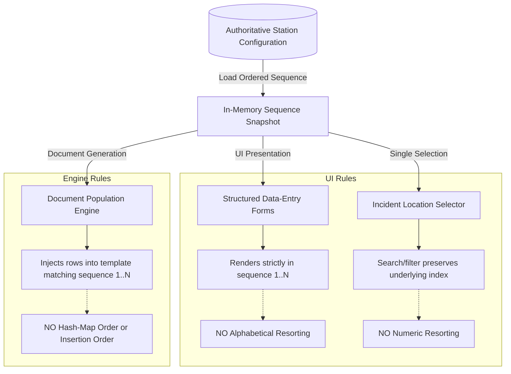
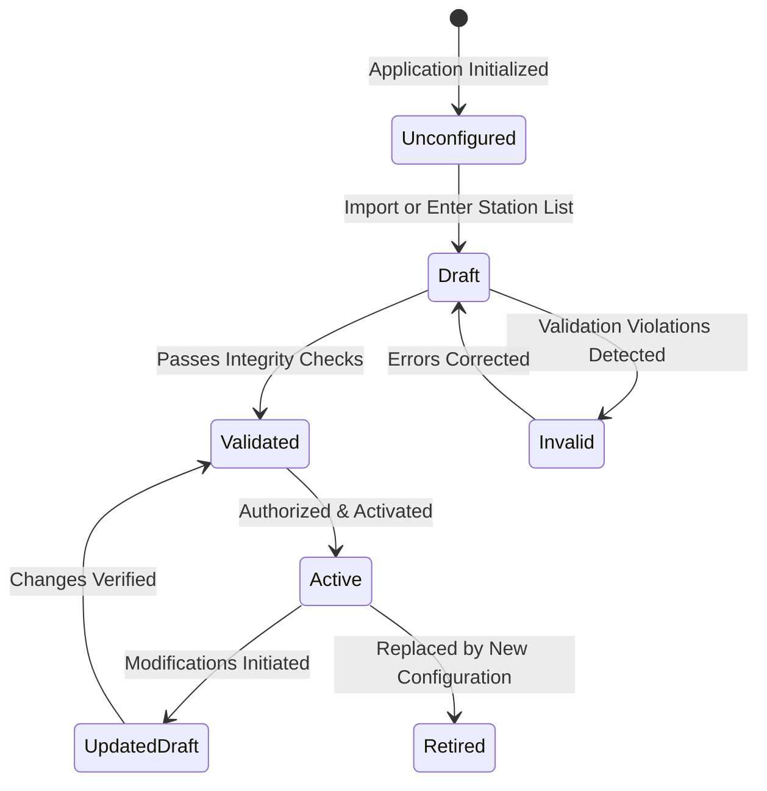

# OpsReport Studio — Station Sequence, Ordering & Configuration Specification

**Document Identifier:** SPEC-STN-001  
**Project ID:** stationops-reporter  
**Approved Product Name:** OpsReport Studio  
**Lifecycle Step:** Step 3 of 45 (Station Sequence, Ordering & Configuration Specification)  
**Status:** Authoritative Architectural Specification  
**Last Updated:** 2026-10-19

---

## 1. Purpose, Scope & Core Mandate

This specification establishes the authoritative architectural and behavioral requirements for station sequence management, station ordering invariants, station identity, and configuration validation in **OpsReport Studio**.

In facility, railway, security, and municipal operations, station inspections follow rigorous operational routes, geographical tracks, or sector sequences. Reordering stations alphabetically or numerically corrupts route continuity, violates regulatory submission standards, and introduces cognitive friction for control room personnel.

### Core Architectural Mandates:

1. **User-Provided Authoritative Source:** Station names and their exact sequence order must originate exclusively from the official list to be supplied by the user. The application shall **never invent station names, station codes, or sequence positions**.
2. **Absolute Sequence Preservation:** Configured station order must be strictly preserved across all data-entry forms, selectors, and exported documents where sequential reporting is mandated.
3. **No Inferred Re-sorting:** Under no circumstance shall the system silently replace the configured order with alphabetical sorting, numerical sorting, database insertion order, or dictionary hash order.
4. **Referential Integrity:** All operational report workflows must source station references from a unified, validated station configuration rather than maintaining ad-hoc or uncoordinated lists.
5. **Fail-Safe Validation:** Damaged, ambiguous, or missing station configurations must trigger clear diagnostic barriers preventing unsafe document generation rather than generating reports with guessed or corrupted station lists.

---

## 2. Evidence Reviewed & Audit Limitations

- **Step 1 Baseline Inspected:** Confirmed `REQ-008` (Authoritative Station Ordering Enforcement) as a P0 Core Requirement.
- **Step 2 Deliverables Inspected:** Verified [OPSREPORT_STUDIO_REPORT_CATALOG.md](file:///e:/Projects/All%20working%20projects/App%20projects%20working/OpsReport%20Studio%20%28working%29/docs/requirements/OPSREPORT_STUDIO_REPORT_CATALOG.md) and [OPSREPORT_STUDIO_DATA_REQUIREMENTS_MATRIX.md](file:///e:/Projects/All%20working%20projects/App%20projects%20working/OpsReport%20Studio%20%28working%29/docs/requirements/OPSREPORT_STUDIO_DATA_REQUIREMENTS_MATRIX.md). Confirmed that 6 out of 7 report categories depend on ordered station rows (`RPT-STATION-LIGHT`, `RPT-FAN`, `RPT-POLE-LIGHT`, `RPT-FIRE-EXTINGUISHER`, `RPT-PILLAR`, `RPT-FENCE`), while `RPT-INCIDENT` depends on a single station selector.
- **Current Workspace Audit:** Confirmed that the authoritative station list has **not yet been supplied by the user**. In compliance with professional requirements discipline, this specification establishes the ordering architecture and contracts without fabricating placeholder station names.

---

## 3. Station vs. Station Sequence Concepts

### 3.1 The Station Entity (Conceptual Definition)

A **Station** represents a distinct physical or operational facility location monitored by the control room.

- **Stable Internal Identifier (`station_id`):** An immutable, system-generated key (e.g., UUID or integer) decoupling the station's identity from its visual label.
- **Official Display Name (`station_name`):** The exact human-readable name of the facility as approved by operations management.
- **Optional Operational Code (`station_code`):** An operational abbreviation or telegraphic code (e.g., `ST-01`), if formally adopted by the customer.
- **Lifecycle State (`status`):** Active or Inactive/Retired.

### 3.2 The Station Sequence (Conceptual Definition)

A **Station Sequence** is an ordered, deterministic collection of station references whose explicit ordinal indexing (`1, 2, ..., N`) governs reporting workflows.

- The sequence is **ordinal, discrete, and non-transmutable** by presentation layers.
- Each position `i` in the sequence binds strictly to exactly one station entity.
- The sequence constitutes an operational invariant: changing the sequence represents a formal configuration change event.

---

## 4. Sequence Architecture: Single vs. Multiple Sequences

| Evaluation Criterion        | Option A: Single Authoritative Sequence                                                     | Option B: Multi-Route / Sector Sequences                                                                        |
| :-------------------------- | :------------------------------------------------------------------------------------------ | :-------------------------------------------------------------------------------------------------------------- |
| **Operational Fit**         | Ideal for linear transit lines, single-campus facilities, or fixed perimeter patrol routes. | Required if operations inspects Northbound vs. Southbound lines or distinct geographic districts independently. |
| **Configuration Burden**    | Very Low: Single ordered list imported once and maintained centrally.                       | High: Requires defining route headers, route-station associations, and route-switching UI.                      |
| **Operator Cognitive Load** | Zero friction: Operators always see their standard operational route.                       | Medium: Operator must choose the active route prior to commencing an inspection.                                |
| **Engine Complexity**       | Minimal: Simple 1D ordered array with deterministic indexing.                               | Higher: Multi-dimensional routing structures with relational junction points.                                   |
| **Testing Scope**           | Straightforward unit and integration assertions on single list invariants.                  | Complex matrix of route-specific sequence validations and cross-route station references.                       |

### Architectural Recommendation:

- **Initial Release Baseline:** **Adopt Option A (Single Authoritative Sequence)** as the mandatory core requirement (`[USER-CONFIRMED]`).
- **Extensibility Safeguard:** The underlying data contract (specified in Deliverable B) shall include an optional `route_tag` or `sector_id` property so that multi-route partitioning can be introduced in post-V1 phases without breaking the core single-sequence schema.

---

## 5. Sequence Preservation Invariants

### 5.1 Invariant 1: Normal Display Order

Whenever an inspection workflow renders stations, the presentation sequence must identically match the sequence indices defined in the active configuration (`index = 1, 2, ..., N`).

- The UI layer is strictly prohibited from applying alphabetical (`A-Z`), reverse alphabetical, or length-based sorting.

### 5.2 Invariant 2: Search, Filtering & Selection Isolation

To support rapid navigation across large station inventories, the application may provide a search or keyword filter.

- Filtering is strictly a **transient visual presentation mask**.
- Typing in a search filter (e.g., "North") temporarily reduces visible items, but selecting or clearing the filter must instantly restore the authoritative sequence.
- A filter action shall **never mutate or re-index** the underlying station collection.

### 5.3 Invariant 3: Report Output Row Order

In multi-station audit reports (`RPT-STATION-LIGHT`, `RPT-FAN`, `RPT-POLE-LIGHT`, `RPT-FIRE-EXTINGUISHER`, `RPT-PILLAR`, `RPT-FENCE`), row generation must proceed strictly along the configured sequence:

- Row `k` in the exported workbook corresponds to Station `k` in the configuration.
- If a template contains pre-printed station names, the document engine must verify that the template's pre-printed order matches the application's configured sequence prior to injecting data.

### 5.4 Invariant 4: Prohibition of Inferred Sorting

Under no condition may the application "guess" an ordering sequence. If a list of station names is imported without explicit sequence indicators, the application must prompt for sequence verification rather than sorting alphabetically or by file parse order.

---

## 6. Station Identification, Name Handling & Uniqueness

### 6.1 Separation of Identity vs. Display Name

- **The Entity ID (`station_id`):** Immutable key assigned at registration. Never changes. Used in draft sessions, historical audit logs, and internal cross-references.
- **The Display Name (`station_name`):** The operational text string rendered on screen and stamped into reports. Can be corrected (e.g., fixing a typo) without severing historical document references.

### 6.2 Duplicate Name Prevention Policy

- **Strict Uniqueness Rule:** Station display names must be case-insensitively unique within the active configuration. Having two identical names (e.g., two entries named "Central Station") creates fatal ambiguity in inspection records.
- **Duplicate Detection:** During configuration import or creation, duplicates must be flagged immediately as blocking validation errors (`VR-STN-003`).

### 6.3 Whitespace Normalization & Character Safeguards

- **Leading/Trailing Whitespace:** Automatically trimmed on import/entry (e.g., `" Grand Central "` normalized to `"Grand Central"`).
- **Internal Collapsed Whitespace:** Consecutive spaces collapsed to single space.
- **Empty / Whitespace-Only Names:** Strictly rejected (`VR-STN-005`).
- **Preservation of Official Punctuation:** Hyphens, apostrophes, and slashes (e.g., `"St. John's"`, `"Terminal 1/2"`) must be preserved exactly as officially designated.

### 6.4 Station Renaming Policy

When an authorized administrative action renames an existing station:

1. **Future Reports:** Will immediately reflect the updated official display name.
2. **Previously Exported Files:** Remain completely unchanged on disk. The application never modifies historical output files.
3. **In-Progress Drafts:** When an operator resumes an in-progress draft created under the previous name, the application must display a non-blocking notification: _"Station [Old Name] has been updated to [New Name] in the active catalog."_

---

## 7. Station Configuration Lifecycle & States

The station configuration moves through a controlled lifecycle to guarantee that unvalidated data never enters production report workflows:

| Lifecycle State  | State Meaning                                                    | Operations Permitted                     | Report Generation Permitted?           |
| :--------------- | :--------------------------------------------------------------- | :--------------------------------------- | :------------------------------------- |
| **Unconfigured** | Application contains zero registered stations.                   | Import list, manual setup.               | **NO (Blocked with clear diagnostic)** |
| **Draft**        | Station list is loaded or edited, but unvalidated.               | Add, remove, reorder, edit names.        | **NO**                                 |
| **Invalid**      | Validation detected duplicates, empty names, or broken sequence. | Correct errors, review error highlights. | **NO (Blocked with exact error list)** |
| **Validated**    | All integrity checks passed; awaiting activation.                | Review summary, activate.                | **NO (Must activate first)**           |
| **Active**       | Authoritative production configuration currently in effect.      | Read-only reference by report workflows. | **YES (Unrestricted generation)**      |
| **Retired**      | Historical configuration superseded by a newer active version.   | Historical audit inspection only.        | **NO for new reports**                 |

---

## 8. Station Source & Provisioning Methods

When the user supplies the authoritative station list, the application will ingest it through one of the following evaluated channels:

| Ingestion Method                          | User Effort | Operational Strengths                                                    | Failure Risks                                                           | Architectural Recommendation       |
| :---------------------------------------- | :---------- | :----------------------------------------------------------------------- | :---------------------------------------------------------------------- | :--------------------------------- |
| **1. Structured File Import (CSV / TXT)** | Very Low    | Fast, zero typing errors, easy to export from corporate dispatch or GIS. | Character encoding issues, unexpected delimiters, blank trailing lines. | **RECOMMENDED PRIMARY CHANNEL**    |
| **2. Spreadsheet Import (`.xlsx`)**       | Low         | Familiar format for control room managers.                               | Header row ambiguity, multiple worksheets, merged cells.                | **RECOMMENDED SECONDARY CHANNEL**  |
| **3. In-App Station Manager Interface**   | Medium      | Built-in UI to view, add, delete, or re-order stations.                  | Higher initial implementation effort.                                   | **RECOMMENDED FOR V1 MAINTENANCE** |
| **4. Direct JSON Config Drop**            | Low (Tech)  | Zero UI required for initial alpha testing.                              | Requires technical file placement in AppData.                           | **RECOMMENDED ALPHA FALLBACK**     |

---

## 9. Configuration Change Behavior & Session Consistency

### 9.1 The Operational Challenge

In 24/7 control room operations, an administrator might update the station sequence while an operator is mid-way through a 50-station lighting inspection shift. Mixing two different station sequence definitions within a single report corrupts audit integrity.

### 9.2 Session Snapshot Consistency Policy (`POL-SESS-01`)

1. **Session Pinning:** When an operator opens an inspection form, the active report session binds to a read-only snapshot of the active station sequence.
2. **Mid-Session Updates:** If a background configuration change occurs while a report session is open:
   - The active session continues using its pinned sequence snapshot until the report is either generated or discarded.
   - Generation succeeds using the snapshot under which the audit was conducted.
3. **Draft Resumption:** When opening a saved draft report:
   - If the active station configuration has changed since the draft was saved, the system alerts the operator: _"The station sequence has changed since this draft was started. Review changes before generating."_
   - The operator is given the option to: (A) Re-align data to the new sequence, or (B) Complete the draft using the original sequence.

---

## 10. Relationship Between Stations and the 7 Report Categories

| Report Category ID          | Station Multiplicity         | Ordering Invariant Mandatory?  | Unit of Reporting          | Template Implication                         |
| :-------------------------- | :--------------------------- | :----------------------------- | :------------------------- | :------------------------------------------- |
| **`RPT-INCIDENT`**          | Single Station per Report    | No (Single Selection)          | 1 Security Event           | Stamped into single document header/bookmark |
| **`RPT-STATION-LIGHT`**     | All Stations (Multi-Row)     | **YES (Strict Sequence 1..N)** | Audit Row per Station      | Injected into sequential table rows          |
| **`RPT-FAN`**               | All Stations (Asset Rows)    | **YES (Strict Sequence 1..N)** | Equipment Rows by Station  | Grouped under ordered station headers        |
| **`RPT-POLE-LIGHT`**        | All Stations (Pole Rows)     | **YES (Strict Sequence 1..N)** | Exterior Rows by Station   | Grouped under ordered station headers        |
| **`RPT-FIRE-EXTINGUISHER`** | All Stations (Cylinder Rows) | **YES (Strict Sequence 1..N)** | Compliance Rows by Station | Grouped under ordered station headers        |
| **`RPT-PILLAR`**            | All Stations (Pillar Rows)   | **YES (Strict Sequence 1..N)** | Structural Rows by Station | Grouped under ordered station headers        |
| **`RPT-FENCE`**             | All Stations (Segment Rows)  | **YES (Strict Sequence 1..N)** | Boundary Rows by Station   | Grouped under ordered station headers        |

---

## 11. Acceptance Criteria for Station Ordering

1. **Explicit Source Guarantee:** The application consumes the authoritative station list supplied by the user without inventing names, codes, or positions.
2. **Ordering Immutability:** Multi-station audit forms and generated documents strictly mirror the configured sequence `1..N`.
3. **No Fallback Sorting:** Alphabetical or numerical sorting is strictly banned from overriding the configured sequence.
4. **Validation Isolation:** Invalid or empty configurations block report generation with clear, actionable diagnostics.
5. **Session Snapshot Isolation:** In-progress report entries cannot be corrupted by mid-shift configuration updates.
6. **Master Immutability Preserved:** Station data injection occurs exclusively in output copies; master templates remain read-only.
